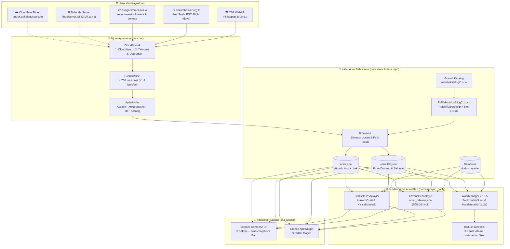

# 🏀 Düdük — Side Brain (İkinci Beyin) Ana Merkezi

> [!IMPORTANT] Proje Vizyonu
> **Düdük**, Ankara'da görev yapan basketbol hakemi **Ahmet Gökalp Göksu** (`"AHMET GÖKALP GÖKSU"`) için özel olarak tasarlanmış, **Maçkolik** deneyimini hakem perspektifine uyarlayan kişisel bir Android uygulamasıdır. Üç bağımsız ve resmi/yarı-resmi veri kaynağını (`assignr.immensus.io`, `ankarabasket.org.tr`, `TBF WebAPI`) tersine mühendislikle birleştirir; 2 haftalık geçici atama penceresini **hiçbir veriyi silmeyen yerel bir JSON arşivine** dönüştürür; %97,9 isabetli bulanık eşleştirme algoritmasıyla resmi skor ve puan durumlarını bağlar; kişisel/genel hakem istatistiklerini ve 2026-2027 görevli ücret tarifesine dayalı kazanç tablolarını hesaplar.

---

## 👤 Kullanıcı ve Hakem Profili

| Alan | Değer / Açıklama |
|---|---|
| **Ad Soyad** | Ahmet Gökalp Göksu |
| **Atama Kayıtlarındaki Tam Adı** | `"AHMET GÖKALP GÖKSU"` (`tr-TR` büyük harf + tek boşluk normalizasyonu: `AdKarsilastirma.anahtar`) |
| **Bölge / İl** | Ankara (`CityNameForLocalLeague=ANKARA`) |
| **Sezon** | `2026-2027` (TBF `seasonId = 174`) |
| **Gözlenen Örnek Atamalar (11 Kasım 2026)** | `ANK-U14E-B-2026-113` (13 Kasım 2026, U 14 Erkek B, 2. Hakem / `referee2`) `ANK-U18E-B-2026-088` (13 Kasım 2026, U 18 Erkek B, 2. Hakem / `referee2`) |
| **Geliştirme Ortamı** | Arch Linux, Hyprland, kullanıcı: `flugel`, proje dizini: `/home/flugel/Projects/duduk` |
| **GitHub Deposu** | `gok8lp/duduk` (Özel / Private depo, sürüm `v0.1.0`) |

---

## 🗺️ Bilgi Ağı İndeksi (Harita / MOC)

Bu **Side Brain**, birbirine çift yönlü `[[wikilink]]` bağlantılarıyla örülmüş 6 ana modül ve 2 kapsamlı referans katmanından oluşur:

### Ana Modüller
1. **[[01 - Veri Kaynakları ve API Analizi]]**
   - Üç ayrı ekosistemin (`assignr.immensus.io`, `ankarabasket.org.tr`, `miniappapi.tbf.org.tr`) uçları, HTTP davranışları, RSC Flight (`self.__next_f.push`) ayrıştırma tekniği, `robots.txt` kısıtları ve kritik veri tuzakları.
2. **[[02 - TBF Maç ve Lig Eşleştirme Algoritması]]**
   - `matchNumber` taşımayan TBF maçlarını `assignr` kayıtlarına bağlayan Türkçe karakter katlama (`fold`), `hallKey`, `teamKey`, Ratcliff/Obershelp (`SequenceMatcher`) benzerliği, `s + 0.3 * slot` formülü ve %97,9 (188/192 maç, 0 yanlış pozitif) doğrulama analizi.
3. **[[03 - Yerel Arşiv, Birleştirme ve Değişiklik Tespiti]]**
   - `assignr`'ın 2 haftalık pencere kısıtını aşan silmesiz `Arsiv` (`arsiv.json`) mimarisi, atomik dosya yazımı (`.tmp` + `.bak`), erteleme (`yerineGelen`) ve kaldırılma (`kaldirildi`) tespiti, 5 bildirim olayı (`YENI_HAFTA`, `YENI_ATAMA`, `ATAMA_DEGISTI`, `ATAMA_KALDIRILDI`, `SKOR_GIRILDI`).
4. **[[04 - Hakem İstatistikleri ve 2026-2027 Ücret Tarifesi]]**
   - `IstatistikHesaplayici` ile kişisel/genel hakem analizleri, partner matrisi, takım performansları; `KazancHesaplayici` ile 2026-2027 Özel Müsabaka Görevli Ücretleri tablosu, TBF Hakemler Talimatı Md. 29 analizi ve `BÖLGE` ücretinin neden `null` ("ücret tanımsız") başladığı.
5. **[[05 - Android Mimari, Senkronizasyon, Bildirimler ve Arayüz]]**
   - Araç zinciri (Gradle 9.8.0, AGP 9.4.1, Kotlin 2.3.21, Compose BOM 2026.09.00, SDK 37, WorkManager 2.10.5), `ZincirKaynak` (Cloudflare → Tailscale → Doğrudan), `HostHizSiniri`, hatırlatma zamanlayıcısı, Glance widget ve Apple tarzı cam (glassmorphism) arayüz mimarisi.

### Referans Katmanı
- **[[Veri Tuzakları ve Uç Durumlar Kataloğu]]** — Tüm kaynaklarda keşfedilen 15+ kritik veri tuzağı ve savunmacı Kotlin çözümleri.
- **[[2026-2027 Ankara Lig Eşleşme Tablosu]]** — 81 lig/grup satırının (`59 eslesti`, `7 kismi`, `15 eslesmedi`) tam dökümü ve TBF `faaliyetId` eşlemeleri.

---

## 🏗️ Sistem Mimarisi Özeti

---

## 📊 Paket ve Bileşen Durum Tablosu

| Paket / Katman | Dosyalar (`com.flugel.duduk.*`) | Sorumluluk | Durum | İlgili Not |
|---|---|---|---|---|
| `data.model` | `Assignr.kt`, `Ankarabasket.kt`, `Tbf.kt`, `Arsiv.kt`, `EsnekSerilestiriciler.kt` | Veri sınıfları, `MacAnahtari`, `GrupAdi`, `AdKarsilastirma`, `EsnekDouble`/`EsnekInt`/`EsnekMetin` | ✅ Tamamlandı | [[01 - Veri Kaynakları ve API Analizi]], [[03 - Yerel Arşiv, Birleştirme ve Değişiklik Tespiti]] |
| `data.net` | `Http.kt`, `Ayristiricilar.kt`, `Kaynaklar.kt` | OkHttp 5 istemcisi, `HostHizSiniri` (700 ms), RSC Flight ayrıştırıcı, `ZincirKaynak` | ✅ Tamamlandı | [[01 - Veri Kaynakları ve API Analizi]], [[05 - Android Mimari, Senkronizasyon, Bildirimler ve Arayüz]] |
| `data.store` | `ArsivDeposu.kt`, `AyarlarDeposu.kt`, `Birlestirici.kt` | Atomik `JsonDosyasi` (`.tmp`/`.bak`), DataStore Preferences, silmesiz birleştirme ve değişiklik tespiti | ✅ Tamamlandı | [[03 - Yerel Arşiv, Birleştirme ve Değişiklik Tespiti]] |
| `data.repo` | `Normalizasyon.kt`, `Eslestirme.kt`, `SalonBulucu.kt`, `DudukDeposu.kt` | `fold`, `salonAnahtari`, `takimAnahtari`, Ratcliff/Obershelp `oran`, `TbfEslestirici`, `LigCozucu`, `GomuluKatalog` | ✅ Tamamlandı | [[02 - TBF Maç ve Lig Eşleştirme Algoritması]] |
| `domain` | `IstatistikHesaplayici.kt`, `KazancHesaplayici.kt` | Tüm hakemlerin ve kullanıcının istatistikleri, `UcretTablosu` ve dönem/sezon kazanç hesapları | ✅ Tamamlandı | [[04 - Hakem İstatistikleri ve 2026-2027 Ücret Tarifesi]] |
| `sync` & `notify` | `SenkronIsi.kt`, `AcilisAlicisi.kt`, `BildirimYoneticisi.kt`, `HatirlatmaHesaplayici.kt` | WorkManager 2.10.5 periyodik ve tek-seferlik işler, `BOOT_COMPLETED` alıcısı, 3 bildirim kanalı | ✅ Tamamlandı | [[05 - Android Mimari, Senkronizasyon, Bildirimler ve Arayüz]] |
| `ui` & `widget` | `DudukApp.kt`, `MainActivity.kt`, `ui/theme/*`, `ui/screens/*`, `ui/nav/*`, `ui/components/*`, `widget/*` | Material 3 + Basketbol turuncusu teması, 5 sekmeli cam (glassmorphism) arayüz, Glance widget | ✅ Tamamlandı | [[05 - Android Mimari, Senkronizasyon, Bildirimler ve Arayüz]] |

---

## 🔑 Temel Mimari İlkeler (Kırmızı Çizgiler)

1. **Hiçbir Veri Silinmez:** `assignr.immensus.io` yalnızca son 2 haftayı döndürür; geçmiş haftaları veren hiçbir uç yoktur. Uygulama her çekimi `arsiv.json` içine birleştirir (`upsert`). Listeden düşen maçlar `kaldirildi`, ertelenen maçların eski kayıtları `yerineGelen` ile işaretlenir.
2. **Birleşik Birincil Anahtar (`matchNumber|date|time`):** Ertelenen maçlar aynı `matchNumber` ile iki kez gelebildiği için (`ANK-U16E-C-2026-153`), `matchNumber` tek başına birincil anahtar olamaz.
3. **Çeyrek ve Canlı Skor Yoktur:** Ankara yerel lig maçlarında hiçbir kaynakta çeyrek skoru veya canlı skor bulunmaz (`genuisId = ""`, `homeTeamScore = []`). Uygulama sahte/uydurma canlı skor göstermez.
4. **BÖLGE Ücreti Sıfır Değil, Tanımsızdır (`null`):** Ankara yerel lig (`BÖLGE`) maçlarının görevli ücreti Gençlik ve Spor İl Müdürlüğü bütçesinden ödenir ve açık kaynaklarda bulunamamıştır. Bu kalemler `tutarTl = null` ("ücret tanımsız") olarak başlar ve toplam kazanca `0 TL` olarak karıştırılmaz.
5. **Nezaket ve `robots.txt` Uyumu:** `ankarabasket.org.tr/api` yolu `robots.txt`'te `Disallow` olduğu için çalışma zamanında çağrılmaz; `season-teams` ve `clubs` verileri `assets/katalog/` altında gömülü tutulur. Her host'a saniyede en fazla ~1,4 istek (`HostHizSiniri(700 ms)`) gönderilir.
