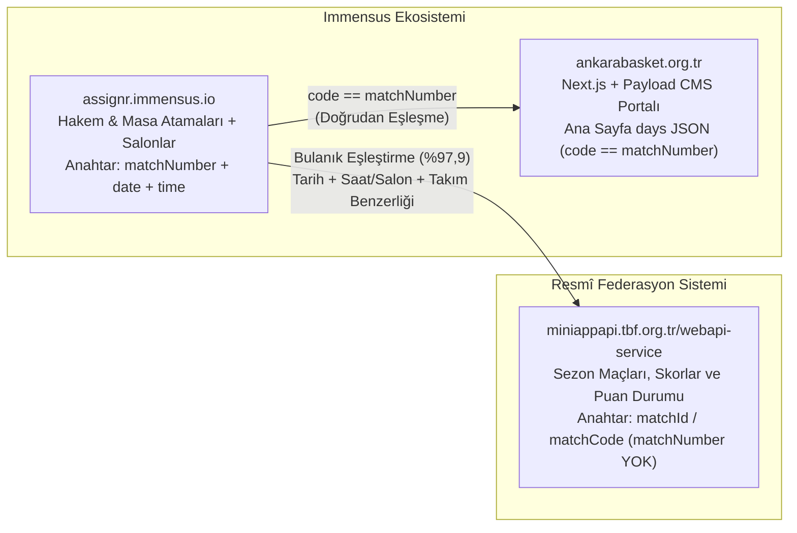

# 🌐 01 — Veri Kaynakları ve Tersine Mühendislik

⬅️ **Üst Merkez:** [[00 - Ana Merkez (MOC)]]
➡️ **İlgili Modüller:** [[02 - TBF Maç ve Lig Eşleştirme Algoritması]] · [[03 - Yerel Arşiv, Birleştirme ve Değişiklik Tespiti]] · [[Veri Tuzakları ve Uç Durumlar Kataloğu]]

> [!NOTE] Gözlem ve Doğrulama Bağlamı
> Tüm uçlar **11 Kasım 2026 (~10:45–11:00 TRT)** tarihinde giriş gerektirmeden, yalnızca `GET` istekleriyle (toplam ~200 istek, host başına ≤ 1–2 istek/sn) bizzat çalıştırılarak doğrulanmıştır (`docs/VERI-KAYNAKLARI.md`). Ham örnek yanıtlar `/home/flugel/Projects/duduk/docs/samples/` dizininde saklanmakta ve birim testlerinde canlı istek yerine kullanılmaktadır.

---

## 🏛️ 0. Üç Sistemli Ekosistem Özeti

Ankara basketbol yerel ligi ve turnuva verileri **üç bağımsız sistem** üzerinde dağılmış durumdadır:



| Veri İhtiyacı | Birincil Kaynak | Yedek / Tamamlayıcı Kaynak | Kotlin Model / Ayrıştırıcı |
|---|---|---|---|
| **Hakem Atamaları** | `assignr` `/api/public/assignments/recent-weeks` | — | `AssignrAtama` (`Assignr.kt`), `AssignrAyristirici` |
| **Masa Görevlileri** | `assignr` `/api/public/assignments/recent-weeks/masa` | — | `AssignrAtama` (`Assignr.kt`), `AssignrAyristirici` |
| **Salon Koordinatları** | `assignr` `/api/public/venues` | `assets/katalog/venues.json` (gömülü) | `Salon` (`Assignr.kt`), `SalonBulucu` |
| **Yakın Fikstür ve Hızlı Skor (BÖLGE)** | `ankarabasket.org.tr` ana sayfa gömülü `days` JSON (RSC Flight) | — | `AbGun`, `AbMac`, `AbSkor` (`Ankarabasket.kt`), `AnkarabasketAyristirici` |
| **Sezon Başı / Geçmiş Maç Skorları** | `TBF` `/api/Match/get-all-matches-for-filter` | `ankarabasket` kulüp sayfası (`/kulupler/<slug>`, son 6 maç) | `TbfMac`, `TbfTakim` (`Tbf.kt`), `TbfAyristirici` |
| **Puan Durumu** | `TBF` `/api/League/get-standings-table` | `ankarabasket` `/puan-durumlari` HTML tablosu | `TbfPuanGrubu`, `TbfPuanSatiri` (`Tbf.kt`) |
| **Lig Kataloğu (`faaliyetId`)** | `TBF` `/api/Altyapilar/filters-results` | `assets/katalog/tbf-catalog.json` (gömülü) | `TbfFaaliyet` (`Tbf.kt`), `LigCozucu` |
| **Lig/Grup ↔ Takım ve Kulüp Logoları** | Gömülü Payload `season-teams.json` & `clubs.json` | Ana sayfa `homeLogo`/`awayLogo` & TBF `logoUrl` | `SezonTakimi`, `Kulup` (`Ankarabasket.kt`), `GomuluKatalog` |

---

## 📋 1. `assignr.immensus.io` (Atama Sistemi)

- **Altyapı:** Spring Boot (404 yanıtları `application/problem+json`, `"No static resource …"` döndürür), Cloudflare arkasında çalışır.
- **Web Arayüzü:** `https://assignr.immensus.io/assignments.html` — yalnızca aşağıdaki üç ucu çağıran tek satır içi script barındırır.
- **Önbellek ve Koşullu İstek Davranışı:** `ETag` ve `Last-Modified` başlıkları **yoktur**. `Cache-Control: no-cache, no-store, max-age=0, must-revalidate` ve `Expires: 0` döner. `If-Modified-Since` veya `If-None-Match` gönderilse bile `200 OK` ve tam gövde döner. `Accept-Encoding: br` (Brotli) ile 128 KB'lık yanıt 10 KB'a düşer.

### 1.1 Hakem Atamaları (`recent-weeks`)
- **Uç:** `GET https://assignr.immensus.io/api/public/assignments/recent-weeks`
- **Parametre Davranışı:** `?city=ankara`, `?city=istanbul`, `?city=izmir` veya `?weeks=6`, `?season=2026`, `?page=1` gibi tüm sorgu parametreleri **yok sayılır**; hepsi parametresiz çağrıyla bayt-özdeş (aynı MD5) yanıt döndürür.
- **Kapsam:** 11 Kasım 2026 gözleminde **301 kayıt** (yalnızca son 2 hafta: `31 Ekim - 6 Kasım 2026` ve `7-13 Kasım 2026`). Hafta Cumartesi günü başlar (Cumartesi–Cuma).

#### Veri Şeması (`AssignrAtama` — `com.flugel.duduk.data.model.Assignr.kt`)

| Alan | JSON Tipi | Örnek Değer | Kritik Notlar ve Normalizasyon |
|---|---|---|---|
| `week` | `String` | `"7-13 Kasım 2026"`, `"31 Ekim - 6 Kasım 2026"` | Biçim tutarsızdır (ay değiştiğinde tire etrafında boşluk olur). Sıralama için **asla** `week` kullanılmaz; `date` kullanılır. |
| `matchType` | `String` | `"BÖLGE"`, `"OKUL"`, `"AGL"`, `"AA"`, `"ABL"` | Müsabaka kategorisi. Bkz. [[02 - TBF Maç ve Lig Eşleştirme Algoritması]] ve [[04 - Hakem İstatistikleri ve Ücret Tarifesi (2026-2027)]]. |
| `date` | `String` | `"2026-11-13"` | `YYYY-MM-DD` (Türkiye yerel tarihi). |
| `time` | `String` | `"18:30"` | `HH:MM` (Türkiye yerel saati, `Europe/Istanbul`, UTC+3). |
| `hall` | `String` | `"ANKARA SPOR SALONU KÜÇÜK"` | Genellikle BÜYÜK HARF (`AA` maçlarında karışık harf olabilir). |
| `league` | `String` | `"U 14 ERKEK B"`, `"U11 PREMİUM"`, `"U12 PREMIUM"` | `İ`/`I` ve `U` sonrası boşluk kullanımı tutarsızdır (`U 14` vs `U11`). |
| `groupName` | `String?` | `"F"`, `"Grup D"`, `"-"`, `"AA"` | `GrupAdi.normalle()` ile baştaki `"Grup "` öneki atılır; `"-"` ve lig adıyla aynı olanlar (`"AA"`) `null` yapılır. |
| `matchNumber` | `String` | `"ANK-U14E-B-2026-113"`, `"OKUL-20261109-1300-f442"` | `BÖLGE`'de kalıcı seri numarasıdır; diğer türlerde oluşturulma tarih/saatini ve rastgele sonek taşır. |
| `teamA`, `teamB` | `String` | `"GALLARDO SK"`, `"ÇANKAYA ÜNİVERSİTESİ SK (B)"` | Ev sahibi ve deplasman takımları. |
| `referee1..3` | `String?` | `"AHMET GÖKALP GÖKSU"` | `referee1` = Başhakem, `referee2` = 1. Yardımcı, `referee3` = 2. Yardımcı (çoğunlukla `""` veya `null`). |
| `tableOfficial1..4` | `null` | `null` | Hakem ucunda daima `null` gelir. |

> [!WARNING] Kritik Tuzak 1: `matchNumber` Tek Başına Benzersiz Değildir! (Ertelenen Maç Tuzağı)
> `recent-weeks` yanıtında **`ANK-U16E-C-2026-153`** numaralı maç **iki kez** yer almaktadır:
> 1. `2026-11-07` saat `17:00` — `ALTINDAĞ SPOR SALONU` (farklı hakem ekibi)
> 2. `2026-11-08` saat `12:30` — `TAHA AKGÜL SPOR SALONU` (yeni hakem ekibi)
>
> **Neden?** Maç ertelendiğinde veya yeniden atandığında `assignr` eski kaydı silmez, aynı `matchNumber` ile yeni tarih/saatli ikinci bir satır ekler.
> **Çözüm (`MacAnahtari`):** Yerel birincil anahtar olarak `matchNumber|date|time` (`MacAnahtari.olustur`) kullanılır. `Birlestirici.ertelemeleriIsaretle()` aynı `matchNumber`'a sahip etkin kayıtlardan en ileri `date + " " + time` değerine sahip olanı güncel kabul eder, eski kaydın `yerineGelen` alanına yeni kaydın anahtarını yazar.

> [!WARNING] Kritik Tuzak 2: `BÖLGE` Dışı `matchNumber` İçindeki Saat Yanıltıcıdır
> Örneğin `OKUL-20261109-1300-f442` kaydının numarasında `1300` yazmasına rağmen `time` alanı `"10:30"` değerindedir. Numara ilk oluşturulma anındaki saati taşır; maç saati değiştiğinde `matchNumber` güncellenmez. Saat bilgisi için daima `time` alanı okunmalıdır.

### 1.2 Masa Görevlisi Atamaları (`recent-weeks/masa`)
- **Uç:** `GET https://assignr.immensus.io/api/public/assignments/recent-weeks/masa`
- **Şema:** `recent-weeks` ile birebir aynıdır; burada `tableOfficial1..4` dolu, `referee1..3` ise `null` gelir (11 Kasım gözleminde **311 kayıt**).
- **Kayıt Kümesi Farkı Tuzağı:** Masa ucu ile hakem ucunun kayıt kümeleri **birebir aynı değildir**:
  - Masa ucunda ulusal/deplasmanlı lig ve Avrupa maçları (`TBL`, `KBSL`, `TKBL`, `TB2L`, `BSL`, `Eurocup`, `Tekerlekli Sandalye Süper Ligi`, `DEP-20261102-1800-454e` numaralı maçlar — **18 kayıt**) yer alır çünkü ulusal maçların masa görevlileri Ankara'dan atanır.
  - `AA` (Anadolu Ajansı Turnuvası) maçları ise hakem ucunda vardır (**8 kayıt**) ama masa ucunda yoktur.
  - **Çözüm:** `Birlestirici.assignr()` iki ucu `matchNumber|date|time` anahtarıyla birleştirir ve `kaynaklar` kümesinde (`"hakem"`, `"masa"`) hangi uçlardan geldiğini ayrı ayrı izler.

### 1.3 Salonlar ve Koordinatlar (`venues`)
- **Uç:** `GET https://assignr.immensus.io/api/public/venues`
- **Şema (`Salon`):** `[{ "name": String, "aliases": [String], "lat": Double, "lng": Double }]` — Toplam **13 salon**.
- **Eşleştirme Mantığı (`SalonBulucu.kt`):** `AdKarsilastirma.anahtar()` (`trim → uppercase(tr-TR) → çoklu boşluğu teke indir`) ile hem `name` hem de `aliases` üzerinden aranır.
  - Örneğin `"ANKARA SPOR SALONU KÜÇÜK"` → `"ANKARA SPOR SALONU"` takma adıyla (`aliases`) eşleşir.
  - **Eksik Salonlar Tuzağı:** `"SİNCAN SPOR KOMPLEKSİ"` ve `"GİMSA PARK AVM SS"` `venues` listesinde **yoktur** (koordinatsız kalır). `SalonBulucu.haritaUri()` koordinat varsa `geo:lat,lng?q=lat,lng(Ad)`, yoksa `geo:0,0?q=Salon+Adi,+Ankara` URI'si üretir.

### 1.4 Geçmiş Haftalar Neden Yok?
- `/api/public/assignments/weeks`, `/all`, `/history`, `/archive`, `/week/2026-10-24` gibi tüm olası uçlar `404` döndürmüştür.
- Wayback Machine (`archive.org/wayback/available`) üzerinde hiçbir anlık görüntü (`"archived_snapshots": {}`) bulunmamaktadır.
- Bu nedenle geçmiş veriyi korumanın **tek yolu** uygulamanın her çekimi kendi yerel arşivine (`arsiv.json`) kaydetmesidir (bkz. [[03 - Yerel Arşiv, Birleştirme ve Değişiklik Tespiti]]).

---

## 🏀 2. `ankarabasket.org.tr` (Next.js App Router + Payload CMS)

### 2.1 `robots.txt` Kuralları ve Mimari Sonuçları
`https://www.ankarabasket.org.tr/robots.txt` içeriği:
- `Allow: /`
- `Allow: /api/media/file/` (Kulüp logoları ve hakem fotoğrafları serbest)
- `Allow: /api/files/file/` (Mevzuat ve ücret tarifesi PDF'leri serbest)
- **`Disallow: /api`** (Payload CMS REST API uçları tarayıcı/bot erişimine yasaklı)
- `Disallow: /r/`

> [!CAUTION] `robots.txt` Uyum Kararı
> `ankarabasket.org.tr/api/<collection>` uçları teknik olarak kimlik doğrulamasız `200 OK` döndürse de `robots.txt` kurallarına saygı gereği uygulama çalışma zamanında `/api` uçlarını **çağırmaz**. Bunun yerine `season-teams` ve `clubs` koleksiyonları `app/src/main/assets/katalog/` dizinine gömülü statik katalog (`GomuluKatalog`) olarak konulmuştur. Çalışma zamanında yalnızca `Allow: /` kapsamında olan ana sayfa HTML'i (`GET https://www.ankarabasket.org.tr/`) çekilir.

### 2.2 Ana Sayfa Next.js RSC Flight (`self.__next_f.push`) Ayrıştırma Tekniği
`ankarabasket.org.tr` istemci tarafında veri çekmek için `fetch` kullanmaz (JS kodunda yalnız `/api/hit` ve `/api/push` vardır). Tüm maç ve skor verisi sunucuda render edilip HTML içindeki **React Server Components (RSC) Flight** yüküne (`self.__next_f.push([1,"..."])`) gömülür.

#### `AnkarabasketAyristirici` (`com.flugel.duduk.data.net.Ayristiricilar.kt`) Algoritması:
1. **Neden Regex Değil Elle Tarayıcı?** Python prototipinde (`docs/samples/ankarabasket/flight_ayristir.py`) kullanılan `self\.__next_f\.push\(\[1,("(?:[^"\\]|\\.)*")\]\)` düzenli ifadesi (regex), Java/Android `java.util.regex.Pattern` motorunda uzun metin parçalarında özyinelemeli geri izleme (backtracking) nedeniyle `StackOverflowError` fırlatmaktadır! Bu yüzden `AnkarabasketAyristirici.flight(html)` metodu karakter-karakter kaçış (`\`) ve tırnak (`"`) takibi yapan doğrusal ($O(N)$) bir tarayıcı olarak yazılmıştır.
2. **Parçaları Birleştirme:** Her `self.__next_f.push([1,"..."])` çağrısının içindeki JSON string literal'i `DudukJson.decodeFromString<String>(...)` ile çözülerek tek bir `akis` metninde birleştirilir.
3. **Köşeli Parantez Dengeleme (`daysDizisi` ve `eslesenKapanis`):** Birleştirilmiş Flight metninde `"days":[` anahtarı bulunur ve string literal'lerin içindeki `[` / `]` karakterleri ile `\"` kaçışları yok sayılarak derinlik sayacı (`derinlik++` / `derinlik--`) sıfırlanana kadar taranır. Kesilen JSON dizisi `List<AbGun>` olarak ayrıştırılır.

#### `days` JSON Şeması (`AbGun`, `AbMac`, `AbSkor` — `Ankarabasket.kt`)
```json
[
  {
    "dateKey": "2026-11-10",
    "label": "10 Kasım Salı",
    "isToday": false,
    "isPast": true,
    "matches": [
      {
        "league": "U 14 KIZ A",
        "group": "A",
        "time": "17:00",
        "venue": "ANKARA SPOR SALONU KÜÇÜK",
        "code": "ANK-U14K-A-2026-023",
        "home": "GALLARDO SK",
        "away": "ÇANKAYA ÜNİVERSİTESİ SK (B)",
        "homeLogo": "/api/media/file/gallardo-sk.png",
        "awayLogo": "/api/media/file/cankaya-universitesi-sk.png",
        "score": { "home": 76, "away": 52 },
        "forfeit": false
      }
    ]
  }
]
```
- **Tarih Penceresi:** 7 gün (**bugün − 2 gün … bugün + 4 gün**). 2 günlük geri pencereden düşen maçın skoru buradan bir daha alınamaz; bu yüzden uygulama günde en az 1–4 kez senkronize olmalıdır.
- **Avantajları:**
  1. `code` alanı `assignr`'daki `matchNumber` ile **birebir aynıdır** (`ANK-U14K-A-2026-023`). Hiçbir bulanık eşleştirmeye gerek kalmadan kesin skor bağlanır!
  2. Skorlar maç bittikten kısa süre sonra (ertesi sabah %100 mevcut, TBF'den 1–2 gün daha hızlı) girilir.
  3. Gelecek haftanın `BÖLGE` maçları henüz `assignr`'da hakem ataması yapılmadan önce burada görünür (14–15 Kasım'daki 34 maç `assignr`'da yokken ana sayfada mevcuttu).

### 2.3 Gömülü Payload CMS Koleksiyonları (`assets/katalog/`)
| Koleksiyon | Kayıt Sayısı | Önemli Alanlar | Uygulamadaki Rolü |
|---|---|---|---|
| `season-teams` | 455 takım | `id`, `club`, `season` (`"2026/27"`), `ageCategory` (`yildiz`=U14, `genc`=U16, `u18`, `buyuk`), `gender`, `league`, `group`, `teamName` | `GomuluKatalog.sezonTakimlari` — `assignr` yazımıyla bilinen lig ve grupların doğrulaması (`LigDurumu.KATALOGDA`). |
| `clubs` | 127 kulüp | `id`, `name`, `slug`, `district`, `lat`, `lng` | `GomuluKatalog.kulupler` — Kulüp bilgileri ve medya eşlemeleri. |
| `officials` | 234 görevli | `name`, `group` (`referee`: 69, `classification-referee`: 28, `table-official`: 137), `classification` (`il`, `a`, `b`, `c`) | Referans veri (uygulama hakem istatistiklerini doğrudan arşivlenen gerçek maçlardan dinamik üretir). |

---

## 🏛️ 3. TBF WebAPI (`miniappapi.tbf.org.tr/webapi-service`)

`www.tbf.org.tr` Nuxt tabanlı bir uygulamadır ve `window.__NUXT__.config.public.apiBaseUrl` değeri `https://miniappapi.tbf.org.tr/webapi-service` adresini işaret eder.

### 3.1 Zarf Yapısı ve Temel Uçlar
Tüm TBF uçları `TbfZarf<T>` (`{ "data": ..., "isSuccess": true, "message": "Success", "problemDetails": null }`) zarfıyla döner:
1. **Lig Kataloğu:** `GET /api/Altyapilar/filters-results?CityNameForLocalLeague=ANKARA&Season=2026-2027&Page=1&PageSize=300`
   - 2026-2027 Ankara sezonu (`seasonId = 174`) için `faaliyetId` listesini döndürür (`22320` Büyük Erkekler, `22328` U14 Erkekler, `22329` U14 Kızlar, `22330` U16 Erkekler, `22331` U16 Kızlar, `22332` U18 Erkekler, `22333` U18 Kızlar vb. Tam tablo için bkz. [[2026-2027 Ankara Lig Eşleşme Tablosu]]).
2. **Maçlar ve Skorlar:** `GET /api/Match/get-all-matches-for-filter?ActivityId=<faaliyetId>&Page=1&PageSize=-1&WeekFilter=*`
   - **Dikkat:** `WeekFilter` parametresi verilmezse **boş liste** döner! Tüm sezon için `WeekFilter=*` zorunludur.
3. **Puan Durumu:** `GET /api/League/get-standings-table?leagueId=<faaliyetId>`
   - Gruplara ayrılmış puan tablosunu (`TbfPuanGrubu` → `standings: List<TbfPuanSatiri>`) döndürür.

### 3.2 TBF Kritik Veri Tuzakları ve `EsnekSerilestiriciler.kt`

> [!WARNING] Kritik Tuzak 3: `"22328.0"` Double ID Tuzağı
> TBF WebAPI aynı tam sayı kimlik alanlarını (`matchId`, `activityId`, `takimIslemId`, `matchStatusId`) farklı uçlarda veya aynı ucun farklı çağrılarında kâh `22328`, kâh `22328.0`, kâh `"22328.0"` olarak döndürmektedir!
> **Çözüm (`EsnekSerilestiriciler.kt`):** Kotlin'de bu alanlar doğrudan `Int`/`Long` olarak tanımlanırsa `JsonDecodingException` ile çöker. Bunun yerine `EsnekDouble`, `EsnekInt` ve `EsnekMetin` özel `KSerializer` sınıfları yazılmıştır. `JsonPrimitive.content.trim().toDoubleOrNull()` üzerinden güvenli dönüşüm yapılır.

> [!WARNING] Kritik Tuzak 4: Oynanmamış Maçlarda `"10. Hafta"` Tarih Metni Tuzağı
> Oynanmamış veya ertelenmiş maçlarda (`matchStatusId` 19 veya 20) `matchDate`, `matchDateOnly` ve `matchTime` alanlarının üçü de ISO tarih yerine **`"10. Hafta"`** gibi Türkçe hafta metni taşır ve `salonAdi = "Atanmadı"` olur (1.702 Ankara maç kaydının 902'si bu şekildedir).
> **Çözüm (`TbfMac.tarih`):** `ISO_TARIH = Regex("""^\d{4}-\d{2}-\d{2}""")` ile kontrol edilir; ISO tarih biçiminde değilse `null` döner.

### 3.3 `matchStatusId` Kod Tablosu ve "Oynandı" Ölçütü

| `matchStatusId` | Resmî Durum Metni (`mac-header`) | Skor Durumu | `TbfMac.hukmen` |
|---|---|---|---|
| **`1`** | Oynandı | Dolu (normal skor) | `false` |
| **`6`** | Tatil Edildi | Boş | `false` |
| **`8`** | Oynandı \| A Takım Hükmen Mağlup | `0` – `20` | `true` |
| **`9`** | Oynandı \| B Takım Hükmen Mağlup | `20` – `0` | `true` |
| **`13`** | Oynandı \| A Takımı Ligden Çekildi / İhraç | `0` – `20` | `true` |
| **`14`** | Oynandı \| B Takımı Ligden Çekildi / İhraç | `20` – `0` | `true` |
| **`19`** | Fikstür / Tarih ve Saat Atanmadı | Boş (**İstisna:** 1 maçta dolu!) | `false` |
| **`20`** | Ertelendi / Tarih ve Saat Atanmadı | Boş | `false` |

- **Statüye Körü Körüne Güvenmeme Kuralı (`TbfMac.oynandi`):** 6 Kasım tarihli bir U14 Erkek maçında (`ANKARA DTY SK`) `matchStatusId == 19.0` olmasına rağmen tarih, salon ve skor alanlarının dolu olduğu saptanmıştır. Bu yüzden `TbfMac.oynandi` özelliği `matchStatusId`'ye değil, **`tarih != null && homeTeam.skor != null && awayTeam.skor != null`** koşuluna bakar.

### 3.4 Çeyrek Skoru ve Canlı Skor Olmadığının Kanıtları
1. TBF `/api/Match/mac-ozet?matchId=350554` ucunda yerel lig maçları için `homeTeamScore: []` ve `awayTeamScore: []` (çeyrek dizileri) tamamen **boştur**.
2. `/api/Match/mac-istatistik`, `mac-leader`, `get-match-report-with-players` ve `game-flow` uçları yerel lig maçlarında boş/sıfır döner.
3. 1.702 Ankara maç kaydının **1.702'sinde de** `genuisId: ""` (FIBA LiveStats / Genius Sports canlı istatistik bağlantısı yok) ve `hasUzatma: false` durumdadır.
4. `ankarabasket.org.tr` yalnızca maç sonu toplam skoru (`score: { home, away }`) ve `forfeit` bayrağını taşır.
5. **Mimari Karar:** Uygulamada çeyrek skoru tablosu veya "CANLI" göstergesi yer almaz; yalnızca kesinleşmiş maç sonu skoru ve hükmen (`hukmen`) durumu gösterilir.
