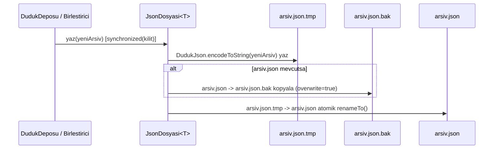
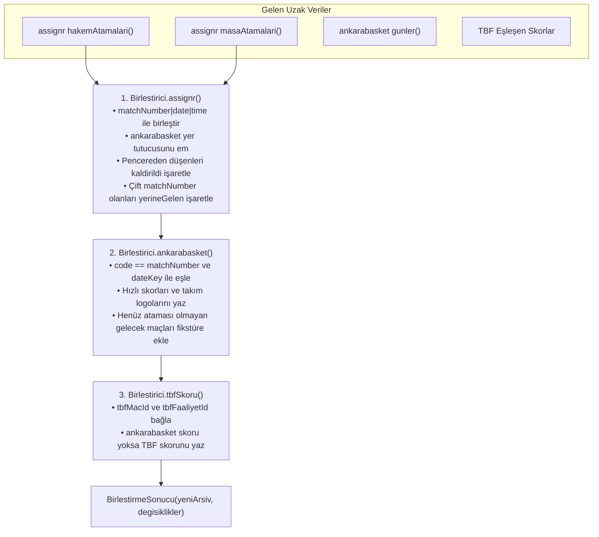

# 💾 03 — Yerel Arşiv, Birleştirme ve Değişiklik Tespiti

⬅️ **Üst Merkez:** [[00 - Ana Merkez (MOC)]]
➡️ **İlgili Modüller:** [[01 - Veri Kaynakları ve Tersine Mühendislik]] · [[02 - TBF Maç ve Lig Eşleştirme Algoritması]] · [[04 - Hakem İstatistikleri ve Ücret Tarifesi (2026-2027)]] · [[05 - Android Mimari, Senkronizasyon, Bildirimler, Arayüz ve Sunucu Zinciri]]

> [!IMPORTANT] Temel Tasarım Felsefesi: "Hiçbir Kayıt Silinmez"
> `assignr.immensus.io` yalnızca son 2 haftanın atamalarını döndürdüğü ve geçmiş haftaları veren hiçbir arşiv ucu bulunmadığı için (`docs/VERI-KAYNAKLARI.md §1.4`), **Düdük** uygulaması çektiği her veriyi kendi yerel JSON arşivine (`files/duduk_veri/arsiv.json`) kalıcı olarak ekler (`upsert`). Sezon boyunca tüm hakem istatistikleri, partner analizleri ve kazanç tabloları bu birikimli arşiv üzerinden hesaplanır.

---

## 🧱 1. Atomik JSON Kalıcılık Katmanı (`ArsivDeposu.kt`)

Uygulamada Room, KSP veya Hilt **bilinçli olarak kullanılmamıştır** (`BUILD.md`). Veriler üç ayrı JSON dosyasında (`arsiv.json`, `onbellek.json`, `ucret_tablosu.json`) ve kullanıcı tercihleri `DataStore<Preferences>` (`duduk_ayarlar`) içinde tutulur.

### `JsonDosyasi<T>` Atomik Okuma / Yazma Mekanizması (`com.flugel.duduk.data.store.ArsivDeposu.kt`)



1. **Atomik Yazma (`yaz`):**
   - Önce yeni JSON metni aynı klasördeki `arsiv.json.tmp` geçici dosyasına yazılır.
   - Mevcut sağlam `arsiv.json` dosyası `arsiv.json.bak` üzerine yedeklenir.
   - `gecici.renameTo(dosya)` ile atomik olarak ana dosya güncellenir. Yazma sırasında pil biter veya uygulama çökerse ana dosya ya da `.bak` yedeği sağlam kalır.
2. **Kurtarmalı Okuma (`oku`):**
   - Önce `arsiv.json` okunup ayrıştırılır.
   - Eğer dosya bozuksa veya `0 byte` ise otomatik olarak `arsiv.json.bak` yedeği okunur ve ana dosyaya geri yazılır.
   - O da başarısız olursa bozuk dosya veri kaybını inceleyebilmek için `arsiv.json.bozuk-<timestamp>` adıyla saklanır ve boş başlangıç nesnesi (`Arsiv()`) döndürülür.
3. **Eşzamanlılık Koruması:** Tüm `oku()`, `yaz()` ve `guncelle()` işlemleri süreç içi `synchronized(kilit)` bloğuyla korunur.

---

## 📦 2. `Arsiv` ve `ArsivMaci` Veri Şeması (`Arsiv.kt`)

Kaynak kod: `com.flugel.duduk.data.model.Arsiv.kt`.

### 2.1 `Arsiv` Kök Modeli
| Alan | Tip | Açıklama |
|---|---|---|
| `surum` | `Int` (`1`) | Şema sürüm numarası. |
| `maclar` | `Map<String, ArsivMaci>` | Birincil anahtar (`matchNumber\|date\|time`) → `ArsivMaci` eşlemesi. |
| `haftalar` | `Map<String, String>` | `assignr` hafta etiketi (`"7-13 Kasım 2026"`) → ilk görülme zamanı (ISO-8601 `Instant`). |
| `ligler` | `Map<String, LigKaydi>` | `"matchType\|league\|grup"` → dinamik keşfedilen lig/grup kaydı (`ESLESTI`, `KATALOGDA`, `TANINMAYAN`). |
| `takimLogolari` | `Map<String, String>` | Takım adı (`assignr` yazımı) → mutlak logo URL'si (`https://www.ankarabasket.org.tr/api/media/file/...`). |
| `gecmis` | `List<Degisiklik>` | Tespit edilen son değişiklik olayları (en yeni başta, en çok `GECMIS_SINIRI = 300` kayıt). |

### 2.2 `ArsivMaci` Modeli ve Durum Bayrakları
```kotlin
@Serializable
data class ArsivMaci(
    val anahtar: String,            // "ANK-U14E-B-2026-113|2026-11-13|18:30"
    val matchNumber: String,        // "ANK-U14E-B-2026-113"
    val matchType: String = "",     // "BÖLGE", "OKUL", "AGL", "ABL", "AA"
    val date: String,               // "2026-11-13"
    val time: String = "",          // "18:30"
    val hall: String = "",          // "ANKARA SPOR SALONU KÜÇÜK"
    val league: String = "",        // "U 14 ERKEK B"
    val grup: String? = null,       // Normalize grup ("F", "D", null)
    val week: String = "",          // "7-13 Kasım 2026"
    val teamA: String = "",         // Ev sahibi
    val teamB: String = "",         // Deplasman
    val hakemler: List<String> = emptyList(), // Sıralı 3 eleman: [1. hakem, 2. hakem, 3. hakem]
    val masa: List<String> = emptyList(),     // Masa görevlileri
    val kaynaklar: Set<String> = emptySet(),  // {"hakem", "masa", "ankarabasket"}
    val ilkGorulme: String = "",
    val sonGorulme: String = "",
    val kaldirildi: String? = null,  // Listeden düştüyse düşme zamanı (ISO)
    val yerineGelen: String? = null, // Ertelendiyse yeni kaydın anahtarı
    val skor: Skor? = null,          // Ev/Deplasman skoru, hükmen durumu ve kaynağı
    val tbfMacId: Long? = null,      // Eşleşen TBF matchId
    val tbfFaaliyetId: Long? = null, // Eşleşen TBF activityId
)
```

- **`etkin` Özelliği (`val etkin: Boolean`):** `kaldirildi == null && yerineGelen == null`. Yalnızca `etkin == true` olan maçlar fikstürde, istatistiklerde, kazanç hesabında ve yaklaşan maç hatırlatmalarında hesaba katılır; ancak geçersizleşen kayıtlar da geçmiş izlenebilirliği için `maclar` haritasında saklanır.
- **Pozisyon Koruma (`hakemler`):** `hakemler` listesi daima 3 elemanlı pozisyon sırasını (`[referee1, referee2, referee3]`) korur; boş pozisyonlar `""` olarak tutulur. Böylece `hakemPozisyonu(ad)` fonksiyonu kullanıcının **1. hakem (Başhakem)**, **2. hakem (1. Yardımcı)** veya **3. hakem (2. Yardımcı)** olduğunu kesin olarak döndürür.

---

## 🔄 3. Birleştirme Mantığı (`Birlestirici.kt`)

Kaynak kod: `com.flugel.duduk.data.store.Birlestirici`.



### 3.1 `Birlestirici.assignr()` Adımları
1. **Hakem ve Masa Uçlarını Birleştirme:**
   - Her iki uçtaki kayıtlar `anahtar = matchNumber|date|time` üzerinden indekslenir.
   - Bir maç yalnız hakem ucunda (`AA` maçları), yalnız masa ucunda (`TBL`/`BSL`/`Eurocup` maçları) veya her ikisinde (`BÖLGE` maçları) bulunabilir.
   - Mevcut kaydın `skor`, `tbfMacId`, `tbfFaaliyetId` ve `ilkGorulme` bilgileri **korunarak** görevli listeleri güncellenir.
2. **`ankarabasket` Yer Tutucu Kaydını Emme (Absorb):**
   - Gelecek haftanın `BÖLGE` maçları `assignr`'da yayınlanmadan önce `ankarabasket.org.tr` ana sayfasından (`kaynaklar == setOf("ankarabasket")`) arşive girmiş olabilir.
   - `assignr` ataması geldiğinde (saati değişmiş olsa bile aynı `matchNumber` ve `date` ile) bu yer tutucu kayıt bulunur, eski anahtarı silinip `assignr` kaydıyla birleştirilir.
3. **Listeden Düşen Atamaları Tespit Etme (`kaldirildi`):**
   - **Kritik Soru:** *2 haftalık pencereden yaşlanarak doğal biçimde düşen eski maçlar ile pencere içindeyken iptal edilen/kaldırılan maçlar nasıl ayırt edilir?*
   - **Çözüm:** Gelen `assignr` yanıtının kapsadığı `week` etiketleri (`hakemHaftalar`) ve `min(date)..max(date)` tarih aralığı (`hakemAralik`) hesaplanır.
   - Yalnızca **bu aktif pencerenin içinde yer alıp** yeni yanıtta artık bulunmayan kayıtlar `kaldirildi = simdi` ile işaretlenir! Pencereden daha eski haftalara ait maçlara dokunulmaz; böylece geçmiş haftalar sonsuza dek `etkin = true` olarak arşivde kalır.
4. **Ertelemeleri İşaretleme (`ertelemeleriIsaretle`):**
   - `kaldirildi == null` olan kayıtlar `matchNumber` bazında gruplanır.
   - Aynı `matchNumber`'a sahip birden fazla kayıt varsa (`ANK-U16E-C-2026-153` örneği), `date + " " + time` değeri en ileri olan kayıt **güncel** (`yerineGelen = null`) kabul edilir; diğerlerinin `yerineGelen` alanına güncel kaydın anahtarı yazılır (`etkin = false` olur).

### 3.2 `Birlestirici.ankarabasket()` ve `Birlestirici.tbfSkoru()`
- **Öncelik Kuralı:** `ankarabasket.org.tr` ana sayfası skorları `code == matchNumber` ile doğrudan ve hızlı verdiği için birincil skor kaynağıdır (`kaynak = "ankarabasket"`).
- `tbfSkoru()` çağrıldığında maçın `tbfMacId` ve `tbfFaaliyetId` kimlikleri her durumda kaydedilir; ancak `skor` alanı yalnızca `e.skor == null` ise (yani `ankarabasket` skoru henüz yoksa) TBF skoruyla doldurulur.

---

## 🔔 4. Değişiklik Tespiti ve 5 Bildirim Olayı (`DegisiklikTuru`)

`Birlestirici`, her senkronizasyonda arşivdeki önceki durum (`eskiBenim`) ile yeni durumu (`yeniBenim`) karşılaştırarak `Degisiklik` nesneleri üretir.

> [!NOTE] İlk Kurulum Koruması (`ilkKurulum = arsiv.maclar.isEmpty()`)
> Uygulama ilk kez kurulduğunda `arsiv.maclar` boştur. İlk çekimde yüzlerce maç ve mevcut atamalar arşive girerken kullanıcıyı bildirim yağmuruna tutmamak için `ilkKurulum == true` iken **hiçbir bildirim olayı üretilmez**.

| `DegisiklikTuru` | Tetiklenme Koşulu | Bildirim Başlığı | Bildirim Kanalı |
|---|---|---|---|
| **`YENI_HAFTA`** | `assignr` yanıtında daha önce `arsiv.haftalar` içinde hiç görülmemiş yeni bir `week` etiketi bulunduğunda | `"Yeni atama haftası yayınlandı"` | `duduk_atama` (Yüksek Öncelik) |
| **`YENI_ATAMA`** | Kullanıcının (`"AHMET GÖKALP GÖKSU"`) görevli olduğu etkin maçlara yeni bir `matchNumber` eklendiğinde | `"Yeni maç atandı"` | `duduk_atama` (Yüksek Öncelik) |
| **`ATAMA_DEGISTI`** | Kullanıcının mevcut bir atamasında;<br>1) Aynı `matchNumber` yeni bir tarih/saate taşındığında (erteleme), **veya**<br>2) Aynı anahtarda `date`, `time`, `hall`, `teamA/B`, kullanıcının rolü (`1. hakem` ↔ `2. hakem`) ya da hakem ekibi (`hakemListesi`) değiştiğinde (`farklar()`) | `"Atamanız değişti"` | `duduk_atama` (Yüksek Öncelik) |
| **`ATAMA_KALDIRILDI`** | Kullanıcının görevli olduğu etkin bir maç aktif pencere içindeyken listeden düştüğünde veya kullanıcı o maçın görevli listesinden çıkarıldığında | `"Atamanız kaldırıldı"` | `duduk_atama` (Yüksek Öncelik) |
| **`SKOR_GIRILDI`** | Kullanıcının görevli olduğu etkin bir maça ilk kez skor girildiğinde (`"Skor girildi"`) veya mevcut skor değiştiğinde (`"Skor düzeltildi"`) | `"Skor girildi"` / `"Skor düzeltildi"` | `duduk_skor` (Normal Öncelik) |

### Erteleme ile Yeni Atama Ayrımı (`Birlestirici.kt` Satır 129–141)
Kullanıcının bir maçının saati veya günü değiştiğinde `anahtar` (`matchNumber|date|time`) değiştiği için kayıt `eskiBenim`'den çıkıp `yeniBenim`'e yeni bir anahtarla girer. `Birlestirici` bunu **"Atamanız kaldırıldı + Yeni maç atandı"** diye iki yanıltıcı bildirim olarak göndermek yerine, çıkan ve eklenen kayıtların `matchNumber` alanlarını karşılaştırır. Eşleşme bulursa tek bir **`ATAMA_DEGISTI`** (`"tarih ... → ..., saat ... → ..."`) olayı üretir!
