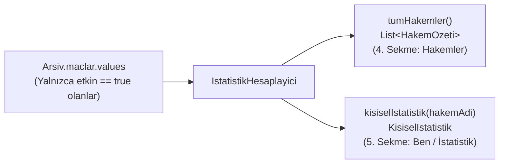

# 💰 04 — Hakem İstatistikleri ve Ücret / Kazanç Tarifesi (2026-2027)

⬅️ **Üst Merkez:** [[00 - Ana Merkez (MOC)]]
➡️ **İlgili Modüller:** [[01 - Veri Kaynakları ve Tersine Mühendislik]] · [[03 - Yerel Arşiv, Birleştirme ve Değişiklik Tespiti]] · [[05 - Android Mimari, Senkronizasyon, Bildirimler, Arayüz ve Sunucu Zinciri]]

> [!IMPORTANT] Kritik İş Kuralı (Gereksinim 6): `BÖLGE` Ücreti Sıfır Sayılmaz!
> Ankara yerel ligi (`BÖLGE`) müsabakalarının görevli ücretleri TBF Özel Müsabaka Tarifesi kapsamında **değildir** ve Gençlik ve Spor İl Müdürlüğü bütçesinden ödendiği için hiçbir açık kaynakta resmi tutar tablosu bulunamamıştır.
> Bu nedenle `UcretTablosu` içinde `BÖLGE` kalemleri **`tutarTl = null` ("ücret tanımsız")** olarak başlar. Kazanç hesaplanırken tanımsız maçlar **kesinlikle `0 TL` sayılmaz**; tanımlı maçların toplamından ayrı olarak `tanimsizMacSayisi` altında raporlanır ve kullanıcı kendi bordrosundaki tutarı uygulama içinden düzenleyebilir.

---

## 📜 1. 2026-2027 Sezonu Özel Müsabaka Görevli Ücretleri (Resmî Belge)

- **Resmî Kaynak:** `https://www.ankarabasket.org.tr/mevzuat` → `"2026-2027 Sezonu Basketbol Özel Müsabakalarında Uygulanacak Görevli Ücretleri"` (`docs/samples/ucret/2026-2027-ozel-musabaka-gorevli-ucretleri.pdf` ve `.txt`, PDF oluşturma tarihi: **10 Temmuz 2026**).

### A. Federasyon Faaliyetleri (Özel Müsabaka ve Turnuvalar — Maç Başı)

| Görevli | BSL (Süper Lig) | KBSL (Kadınlar Süper Lig) | TBL (1. Lig) | TKBL (Kadınlar 1. Lig) | TB2L (2. Lig) | BGL (Basketbol Gençler Ligi) | EBBL / KBBL (Bölgesel Lig) |
|---|---|---|---|---|---|---|---|
| **Hakemler** | **14.000 TL** | **9.500 TL** | **8.500 TL** | **5.000 TL** | **5.000 TL** | **4.250 TL** | **4.250 TL** |
| **Masa Görevlileri** | 1.700 TL | 1.700 TL | 1.400 TL | 1.400 TL | 1.400 TL | 1.400 TL | 1.400 TL |
| **Temsilci \*** | 4.250 TL | 3.750 TL | 3.750 TL | 3.250 TL | 3.250 TL | 3.250 TL | 3.250 TL |
| **İstatistik Görevlisi** | 1.700 TL | 1.700 TL | 1.400 TL | 1.400 TL | 1.400 TL | 1.400 TL | 1.400 TL |

> **Notlar (Bölüm A):**
> - `*` Sadece turnuvalarda görevlendirme yapılır; iki takım arasındaki hazırlık maçlarında temsilci görevlendirilmez.
> - Farklı liglerde yer alan takımların aralarında yapacağı özel maçlarda **üst lig rayici** uygulanır.
> - İl dışından gelen hakem ve temsilcilerin yol ve konaklama ücretleri ev sahibi kulüplere aittir.

### B. İl İçi Faaliyetler (Ankara İçi Özel Turnuvalar — Maç Başı)

| Görevli | Büyükler (18+ Yaş) Şirketler Arası / Reklam / Sponsorlu — **Erkek** | Büyükler (18+ Yaş) Şirketler Arası / Reklam / Sponsorlu — **Kadın** | Kulüp Altyapı Takımları (**Erkek / Kadın**) | Üniversite ve Okullar Arası, Kamu Yararına Kurum / STK Sosyal Sorumluluk (**Erkek / Kadın**) | MEB / Valilik / Kaymakamlık 18 Yaş Altı (**½ Tarife \***) |
|---|---|---|---|---|---|
| **Hakemler** | **3.250 TL** | **2.600 TL** | **1.700 TL** | **1.700 TL \*** | **850 TL** |
| **Masa Görevlileri** | **1.100 TL** | **1.100 TL** | **850 TL** | **850 TL \*** | **425 TL** |
| **Temsilci \*\*** | 1.400 TL | 1.250 TL | 1.100 TL | 1.100 TL \* | 550 TL |

> **Notlar (Bölüm B):**
> - `*` *"Valilik, Kaymakamlık ve Milli Eğitim'in düzenlediği 18 yaş altı karşılaşma ve turnuvalarda tüm görevlilere yukarıdaki tarifenin **1/2'si** ödenir."* (Hakem: `1.700 / 2 = 850 TL`, Masa: `850 / 2 = 425 TL`).
> - `**` Yalnızca turnuvalarda görevlendirme yapılır.
> - Belgede **Başhakem / Yardımcı Hakem** ücret farkı **yoktur**; tüm hakemlere aynı maç başı ücret ödenir.
> - Belgede U18 / U16 / U14 / U12 yaş grubu ayrımı **yoktur**; tamamı "Kulüp Altyapı Takımları" sütununa tabidir.

### C. Açık Hava Turnuvaları (3x3 vb. — Seans Başı, En Fazla 6 Saat)
- **Hakemler:** `4.250 TL / Seans`
- **Masa Görevlileri:** `2.600 TL / Seans`
- **Temsilci:** `3.500 TL / Seans`

---

## ⚖️ 2. Hukuki ve Mevzuat Analizi: `BÖLGE` Ücreti Neden Bulunamadı?

- **Resmî Dayanak:** TBF **Hakemler Talimatı** (Yürürlük: 09.07.2025, `BB68C718D5804F8ABF7236BD995452D2_hakemler-talimati.pdf`, Sayfa 19, `docs/samples/ucret/hakemler-talimati-md29-s19-{a,b}.png`):
  - **Madde 29/(2):** Federasyon faaliyetleri ve özel müsabakalarda görev yapan hakemlerin müsabaka tazminatları MHK önerisi ve TBF Yönetim Kurulu onayı ile sirkülerle belirlenir.
  - **Madde 29/(4):** *"Yerel Lig Faaliyetlerinde görev yapacak müsabaka görevlilerinin müsabaka tazminatları, yol ve konaklama giderleri **Genel Müdürlük mevzuat ve uygulamaları kapsamında İl Müdürlükleri bütçesinden ödenir.**"*
- **Sonuç:** `BÖLGE` (Ankara yerel ligi: U14, U16, U18, U21, Büyük Erkekler, Büyük Kadınlar) maçlarının ödemesini TBF değil, **Ankara Gençlik ve Spor İl Müdürlüğü (GSB)** kendi bütçe ve mevzuat katsayılarına göre yapmaktadır. Bu tutar ne `ankarabasket.org.tr/mevzuat` (12 belge) ne de TBF doküman/sirküler arşivinde (128 belge) yer almaktadır.

---

## 🧮 3. `KazancHesaplayici` ve Düzenlenebilir `UcretTablosu` (`KazancHesaplayici.kt`)

Kaynak kod: `com.flugel.duduk.domain.KazancHesaplayici.kt` (`files/duduk_veri/ucret_tablosu.json`).

### 3.1 Varsayılan Ücret Kalemleri (`UcretTablosu.varsayilanKalemler()`)

| Kalem Kodu (`kod`) | `matchType` | `kategori` | `rol` | Başlangıç `tutarTl` | Açıklama / Dayanak |
|---|---|---|---|---|---|
| `BOLGE_ALTYAPI_HAKEM` | `BÖLGE` | `ALTYAPI` | `HAKEM` | **`null` (Ücret Tanımsız)** | Resmî yerel lig (U14/U16/U18/U21) — kullanıcı bordrosundan girer |
| `BOLGE_BUYUK_ERKEK_HAKEM` | `BÖLGE` | `BUYUK_ERKEK` | `HAKEM` | **`null` (Ücret Tanımsız)** | Resmî yerel lig Büyük Erkekler — kullanıcı bordrosundan girer |
| `BOLGE_BUYUK_KADIN_HAKEM` | `BÖLGE` | `BUYUK_KADIN` | `HAKEM` | **`null` (Ücret Tanımsız)** | Resmî yerel lig Büyük Kadınlar — kullanıcı bordrosundan girer |
| `BOLGE_MASA` | `BÖLGE` | `GENEL` | `MASA` | **`null` (Ücret Tanımsız)** | Resmî yerel lig masa görevi — kullanıcı bordrosundan girer |
| `OZEL_ALTYAPI_HAKEM` | `AGL` | `ALTYAPI` | `HAKEM` | **`1.700 TL`** | Özel Müsabaka Tarifesi §B: Kulüp altyapı takımları (E/K) |
| `OZEL_ALTYAPI_MASA` | `AGL` | `ALTYAPI` | `MASA` | **`850 TL`** | Özel Müsabaka Tarifesi §B: Kulüp altyapı masa görevlisi |
| `OZEL_BUYUK_ERKEK_HAKEM` | `ABL` | `BUYUK_ERKEK` | `HAKEM` | **`3.250 TL`** | Özel Müsabaka Tarifesi §B: Büyükler (18+) Erkek |
| `OZEL_BUYUK_KADIN_HAKEM` | `ABL` | `BUYUK_KADIN` | `HAKEM` | **`2.600 TL`** | Özel Müsabaka Tarifesi §B: Büyükler (18+) Kadın |
| `OZEL_BUYUK_MASA` | `ABL` | `GENEL` | `MASA` | **`1.100 TL`** | Özel Müsabaka Tarifesi §B: Büyükler (18+) Masa görevlisi |
| `AA_KURUM_HAKEM` | `AA` | `GENEL` | `HAKEM` | **`3.250 TL`** | Kurum turnuvası (Şirketler arası 3.250 TL / Kamu 1.700 TL — düzenlenebilir) |
| `OKUL_HAKEM` | `OKUL` | `GENEL` | `HAKEM` | **`850 TL`** | MEB 18 yaş altı ½ tarife önerisi (`1.700 × ½ = 850 TL`) |
| `OKUL_MASA` | `OKUL` | `GENEL` | `MASA` | **`425 TL`** | MEB 18 yaş altı ½ tarife önerisi (`850 × ½ = 425 TL`) |

### 3.2 Eşleştirme ve Dönem Özeti Mantığı (`KazancHesaplayici.hesapla`)
1. Arşivdeki `etkin && gorevliMi(hakemAdi)` koşulunu sağlayan tüm maçlar tarih/saat sırasıyla (`sortedByDescending`) taranır.
2. Kullanıcının o maçtaki rolü (`hakemPozisyonu != null` ise `GorevRolu.HAKEM`, değilse `GorevRolu.MASA`) belirlenir.
3. `kalemBul(mac, rol, tablo)` fonksiyonu `mac.matchType` ve `LigAdi.ayristir(mac.league)` (`yas`, `cinsiyet`) bilgilerine bakarak ilgili `UcretKalemi`'ni bulur.
4. **Dönem ve Sezon Özeti (`DonemKazancOzeti`):**
   - Maçlar `YYYY-MM` ay anahtarına göre gruplanarak `aylikOzetler` ve tüm maçlar üzerinden `sezonOzeti` üretilir:
   - `toplamMacSayisi`: O dönemdeki toplam görev sayısı.
   - `tanimliMacSayisi`: `tutarTl != null` olan maçların sayısı.
   - `tanimsizMacSayisi`: `tutarTl == null` olan ("ücret tanımsız") maçların sayısı.
   - `kesinToplamTl`: Yalnızca ücreti tanımlı olan maçların toplamı (`tanimlilar.sumOf { it.tutarTl ?: 0 }`).

---

## 📊 4. Hakem İstatistik Motoru (`IstatistikHesaplayici.kt`)

Kaynak kod: `com.flugel.duduk.domain.IstatistikHesaplayici.kt`.

### 4.1 Genel Hakemler Özeti (`tumHakemler` — Gereksinim 4)
Arşivdeki tüm etkin maçları tarayarak Ankara'da görev yapmış her hakem için `HakemOzeti` üretir ve toplam maç sayısına göre çoktan aza (eşitlikte alfabetik) sıralar:
- `toplamMac`: Toplam çıktığı maç sayısı.
- `birinciHakemSayisi`, `ikinciHakemSayisi`, `ucuncuHakemSayisi`: `referee1`, `referee2`, `referee3` pozisyonlarındaki görev dağılımı.
- `ligler: Map<String, Int>`: Hangi liglerde kaç maça çıktığı (çoktan aza sıralı).
- `enSikPartner: PartnerSayisi?` ve `tumPartnerler: List<PartnerSayisi>`: Aynı maçta birlikte düdük çaldığı hakem arkadaşları ve birlikte çıktıkları maç sayıları.

### 4.2 Kişisel Hakem İstatistiği (`kisiselIstatistik` — Gereksinim 5)
Kullanıcının (`"AHMET GÖKALP GÖKSU"`) kendi maçları üzerinden `KisiselIstatistik` modelini üretir:
1. **Görev Sayıları:** `toplamHakemMaci`, `toplamMasaMaci`, `birinciHakemMaci` (Başhakem), `ikinciHakemMaci` (1. Yardımcı), `ucuncuHakemMaci` (2. Yardımcı).
2. **Lig Dağılımı (`ligDagilimi: Map<String, Int>`):** En çok görev alınan ligden en aza doğru dağılım.
3. **Aylık Dağılım (`ayDagilimi: Map<String, Int>`):** `"YYYY-MM"` (ör. `"2026-10"`, `"2026-11"`) kronolojik sırasıyla aylık maç temposu.
4. **Salon Dağılımı (`salonDagilimi: Map<String, Int>`):** Hangi spor salonunda kaç maça çıkıldığı.
5. **En Sık Eşleşilen Hakemler (`enSikPartnerler: List<PartnerSayisi>`):** Kullanıcının birlikte en çok maça çıktığı hakem partnerleri.
6. **Düdük Çalınan Maçlardaki Takımların Sonuçları (`takimSonuclari: List<TakimSonucOzeti>`):**
   - Kullanıcının hakem olarak yönettiği maçlarda yer alan her takım (`teamA` ve `teamB`) için:
   - Kaç maçına çıkıldığı (`macSayisi`), bu maçlarda takımın kaç galibiyet (`galibiyet`) ve mağlubiyet (`maglubiyet`) aldığı, attığı (`atilanSayi`) ve yediği (`yenenSayi`) toplam sayı ile averajı (`averaj = atilanSayi - yenenSayi`).
