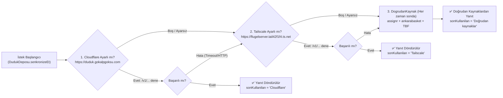

# 📱 05 — Android Mimari, Senkronizasyon, Bildirimler, Arayüz ve Sunucu Zinciri

⬅️ **Üst Merkez:** [[00 - Ana Merkez (MOC)]]
➡️ **İlgili Modüller:** [[01 - Veri Kaynakları ve Tersine Mühendislik]] · [[02 - TBF Maç ve Lig Eşleştirme Algoritması]] · [[03 - Yerel Arşiv, Birleştirme ve Değişiklik Tespiti]] · [[04 - Hakem İstatistikleri ve Ücret Tarifesi (2026-2027)]]

---

## 🛠️ 1. Araç Zinciri ve Bilinçli Mimari Kararlar (`BUILD.md` & `libs.versions.toml`)

Proje `/home/flugel/Projects/duduk` dizininde yer alır ve `koharia-reader` projesinde doğrulanmış modern araç zincirini kullanır:

| Bileşen | Sürüm / Değer | Mimari Gerekçe ve Notlar |
|---|---|---|
| **Gradle Wrapper** | `9.8.0` | En güncel kararlı yapı sistemi |
| **Android Gradle Plugin (AGP)** | `9.4.1` | Yerleşik Kotlin desteği kullanır; ayrıca `kotlin-android` eklentisi **kullanılmaz** |
| **Kotlin** | `2.3.21` | `kotlin-compose` ve `kotlin-serialization` eklentileriyle |
| **JDK / `JAVA_HOME`** | `17` (`/usr/lib/jvm/java-17-openjdk`) | Sistem varsayılanı JDK 27 olsa da Android derlemesi JDK 17 ile çalıştırılır |
| **`compileSdk` / `targetSdk` / `minSdk`** | `37` / `37` / `26` | Build-Tools: `37.0.0`, Android SDK: `/home/flugel/android-sdk/sdk` |
| **Compose BOM** | `2026.09.00` | Material 3, Foundation, UI, Material Icons Extended |
| **Navigation & Lifecycle** | `2.10.2` / `2.11.0` | `navigation-compose`, `lifecycle-viewmodel-compose`, `lifecycle-runtime-compose` |
| **WorkManager** | **`2.10.5` (Sabitlendi!)** | **Kritik:** WorkManager `2.11+` sürümleri bazı üretici API 34 cihazlarında `JobScheduler.forNamespace()` hatası yüzünden uygulama açılışında çökmektedir. Bilinçli olarak `2.10.5`'te tutulmuştur; **yükseltilmemelidir**. |
| **DataStore Preferences** | `1.3.0` | `duduk_ayarlar` (kullanıcı adı, sunucu adresleri, bildirim tercihleri) |
| **Glance AppWidget** | `1.2.0` | `glance-appwidget` + `glance-material3` (Ana ekran sıradaki maç widget'ı) |
| **Ağ ve Ayrıştırma** | OkHttp `5.3.2`, Serialization `1.11.0`, Jsoup `1.22.2` | Coroutines `1.11.0`, birim testlerinde `mockwebserver3` ve `docs/samples` dosyaları |
| **Room / KSP / Hilt** | **YOK (Eklenmedi)** | Derleme hızını korumak ve KSP/Hilt karmaşasından kaçınmak için tekil bağımlılıklar `DudukApp` (`Application`) içinde `lazy` olarak tutulur, kalıcılık atomik JSON dosyalarıyla sağlanır. |

### Tek Satır Derleme ve Birim Test Komutu
```sh
cd /home/flugel/Projects/duduk && JAVA_HOME=/usr/lib/jvm/java-17-openjdk ./gradlew :app:assembleDebug :app:testDebugUnitTest
```

---

## 🌐 2. Bağlantı Sırası (`ZincirKaynak`) ve Host Başına Hız Sınırı (`HostHizSiniri`)

Kaynak kodlar: `com.flugel.duduk.data.net.Kaynaklar.kt` ve `Http.kt`.

### 2.1 Üç Kademeli Bağlantı Zinciri (Gereksinim 11)
Uygulama tüm uzak veri ihtiyaçlarını `VeriKaynagi` arayüzü üzerinden karşılar. `ZincirKaynak.kur()` fonksiyonu kullanıcı ayarlarına (`KullaniciAyarlari`) bakarak aşağıdaki öncelik sırasıyla yedekli (fallback) bir zincir oluşturur:



1. **1. Öncelik — Cloudflare Tüneli (`SunucuKaynagi("Cloudflare", ...)`):**
   - Planlanan adres: `https://duduk.gokalpgoksu.com` (Ayarlardan girilir, koda gömülmez; `Authorization: Bearer <anahtar>` başlığı gönderir).
   - Sunucu istemcisi (`sunucuHttpIstemcisi`) hızlı fallback için kısa zaman aşımı (`baglantiZamanAsimiSn = 4`, `okumaZamanAsimiSn = 8`) kullanır.
2. **2. Öncelik — Tailscale Serve (`SunucuKaynagi("Tailscale", ...)`):**
   - Planlanan adres: `https://flugelserver.tail42f1f4.ts.net` (Tailnet içi özel port). Cloudflare ulaşılamazsa veya henüz açılmamışsa devreye girer.
3. **3. Öncelik — Doğrudan Açık Kaynaklar (`DogrudanKaynak`):**
   - Her zaman zincirin sonunda yer alır. İlk sürümde sunucu adresleri boş başladığı için uygulama doğrudan `assignr.immensus.io`, `ankarabasket.org.tr` ve `miniappapi.tbf.org.tr` uçlarından çalışır.

### 2.2 Host Başına Hız Sınırı (`HostHizSiniri` — `Http.kt`)
- Kaynak siteler Cloudflare arkasında olduğu ve `DEVIR.md` kuralları gereği **host başına saniyede 1–2 istekten fazla atılmaması** gerektiği için `HostHizSiniri` OkHttp `Interceptor` sınıfı yazılmıştır.
- Her `host` (`assignr.immensus.io`, `www.ankarabasket.org.tr`, `miniappapi.tbf.org.tr`) için ayrı kilit (`synchronized(kilit(host))`) ve son istek zamanı (`sonIstek[host]`) tutulur.
- Aynı host'a yapılan ardışık iki istek arasında en az **`enAzAralikMs = 700 ms`** (saniyede ≤ ~1,4 istek) beklenir.
- Tüm isteklere tanımlayıcı `User-Agent: Duduk/0.1 (Android; kisisel hakem takip uygulamasi)` başlığı eklenir.

---

## ⏰ 3. Senkronizasyon ve Bildirim Mimarisi (`sync` & `notify`)

Kaynak kodlar: `SenkronIsi.kt`, `AcilisAlicisi.kt`, `BildirimYoneticisi.kt`, `HatirlatmaHesaplayici.kt`.

### 3.1 WorkManager İşçileri ve Zamanlama (`SenkronZamanlayici`)
1. **Periyodik Senkronizasyon (`SenkronIsi`):**
   - `PeriodicWorkRequestBuilder<SenkronIsi>(3, TimeUnit.HOURS, 30, TimeUnit.MINUTES)` ile **3 saatte bir** (30 dk esneklik penceresi, `NetworkType.CONNECTED` kısıtıyla) çalışır.
   - `ExistingPeriodicWorkPolicy.KEEP` ile mevcut zamanlama korunur.
   - `DudukApp.arkaPlanSenkronizeEt()` metodunu çağırır: atamaları, `ankarabasket` günlerini, TBF puan durumlarını (6 saatten eskiyse) ve geçmiş skorsuz `BÖLGE` maçlarının TBF eşleştirmelerini yapar.
2. **Kesin Zamanlı Maç Hatırlatma İşçisi (`HatirlatmaIsi`):**
   - `HatirlatmaHesaplayici.planlanacakGecikmelerDk()` gelecek etkin görev maçları için:
     - **1 Gün Önce (`1GUN`):** Maç saatine `kalanDk - 1440` dakika kala (`"Yarın maçınız var"`),
     - **2 Saat Önce (`2SAAT`):** Maç saatine `kalanDk - 120` dakika kala (`"Maçınıza 2 saat kaldı"`)
     tetiklenecek tek-seferlik (`OneTimeWorkRequestBuilder<HatirlatmaIsi>`) işler kurar.
   - Ayrıca periyodik senkron sırasında `HatirlatmaHesaplayici.zamaniGelenler()` (1 gün için `136..1560 dk` penceresi, 2 saat için `5..135 dk` penceresi) kontrol edilerek olası gecikmeler telafi edilir.
   - Gönderilen her hatırlatma `onbellek.json` içindeki `gonderilenHatirlatmalar` kümesine (`"macAnahtari|1GUN"`, `"macAnahtari|2SAAT"`) kaydedilerek mükerrer bildirim önlenir.
3. **Cihaz Yeniden Başlatma Alıcısı (`AcilisAlicisi`):**
   - `Intent.ACTION_BOOT_COMPLETED` ve `Intent.ACTION_MY_PACKAGE_REPLACED` yayınlarını dinler; telefon yeniden açıldığında hem periyodik WorkManager işini hem de yaklaşan maç hatırlatmalarını yeniden kurar.

### 3.2 Bildirim Kanalları (`BildirimYoneticisi.kt`)
Android 8.0+ için 3 ayrı bildirim kanalı oluşturulur ve Android 13+ (`TIRAMISU`) için `POST_NOTIFICATIONS` çalışma zamanı izni kontrol edilir:
- **`duduk_atama`** (*Atamalar ve Değişiklikler* — `IMPORTANCE_HIGH`): `YENI_HAFTA`, `YENI_ATAMA`, `ATAMA_DEGISTI`, `ATAMA_KALDIRILDI`.
- **`duduk_hatirlatma`** (*Maç Hatırlatmaları* — `IMPORTANCE_HIGH`): Maçtan 1 gün ve 2 saat önce hatırlatmalar.
- **`duduk_skor`** (*Maç Skorları* — `IMPORTANCE_DEFAULT`): Görev alınan maçın skoru girildiğinde/düzeltildiğinde (`SKOR_GIRILDI`).
- Bildirime tıklandığında `EXTRA_MAC_ANAHTARI` ile doğrudan ilgili maçın ayrıntı ekranı açılır.

---

## 🎨 4. Arayüz (Jetpack Compose) ve Glance Widget Mimarisi

### 4.1 Apple Tarzı Cam (Glassmorphism) Gezinme ve Renk Sistemi
- **Tema (`DudukTheme` — `ui/theme/Theme.kt` & `Color.kt`):**
  - Android 12+ (`API 31 / S`) cihazlarda duvar kâğıdından türeyen dinamik renkler (`dynamicDarkColorScheme` / `dynamicLightColorScheme`), diğer durumlarda **Basketbol Turuncusu** (`Light: #9A4600`, `Dark: #FFB688`, koyu arka plan `#14181F`) etrafında kurulu özel Material 3 paleti kullanılır.
- **Yüzen Cam Gezinme Çubuğu ve Üst Başlık (Gereksinim 9):**
  - Alt gezinme çubuğu (Bottom Navigation Bar) ve üst başlık (Top Bar) içeriğin üzerinde yüzen, yarı saydam ve arkasındaki kayan içeriği bulanıklaştıran (Apple / iOS tarzı glassmorphism) yapıda tasarlanmıştır.
  - Android 12+ (`API 31+`) cihazlarda `RenderEffect` / gerçek bulanıklık (`blur`), daha eski API seviyelerinde (API 26–30) zarif yarı saydam yüzey rengi ve ince kenarlık (border) kullanılır.
  - Sekme değişimlerinde hafif dokunsal geri bildirim (`HapticFeedback`), aşağı çekerek yenileme (Pull-to-Refresh), yükleme sırasında iskelet görünüm (Shimmer/Skeleton) ve akıcı ekran geçiş animasyonları yer alır.

### 4.2 Beş Ana Sekme ve Ekranlar
1. **Maçlarım:** Kullanıcının gelecek ve geçmiş maçları. Gelecek maçlarda canlı geri sayım (gün/saat/dakika), salon harita bağlantısı (`SalonBulucu.haritaUri`), lig/grup, takımlar (puan sırası ve averajıyla), hakem ekibi, masa görevlileri ve skor.
2. **Fikstür:** Arşivdeki tüm maçlar; lig, gün ve spor salonuna göre anlık süzgeç (filtre).
3. **Puan Durumu:** TBF'den çekilen tüm yerel lig ve grupların (`O, G, M, A, Y, Av, P`) güncel puan tabloları ve tanınmayan ligler bilgi bölümü.
4. **Hakemler:** Ankara'daki tüm hakemlerin maç sayıları, görev aldıkları ligler ve en sık eşleştikleri partnerler (`IstatistikHesaplayici.tumHakemler`).
5. **Ben / İstatistik & Kazanç:**
   - Kişisel hakem/masa maç sayıları, 1./2./3. hakem dağılımı, aylara/liglere/salonlara göre dağılım, en sık partnerler, yönetilen maçlardaki takımların galibiyet/mağlubiyet/averaj karnesi.
   - **Kazanç ve Ücret Tablosu Ekranı:** Aylık ve sezonluk kesin kazanç toplamı, `BÖLGE` tanımsız maç sayısı uyarısı ve her kalemin (`UcretKalemi`) kullanıcı tarafından düzenlenebildiği interaktif tarife ekranı.
   - **Ayarlar Ekranı:** Hakem adı, Cloudflare/Tailscale sunucu URL ve anahtarı, bildirim tercihleri, son senkron zamanı ve kullanılan aktif kaynak (`sonKullanilan`).

### 4.3 Ana Ekran Widget'ı (Jetpack Glance — Gereksinim 10)
- `androidx.glance:glance-appwidget` ve `glance-material3` kullanılarak kullanıcının **sıradaki ilk etkin maçını** (tarih, saat, kalan süre, takımlar, salon ve lig) ana ekranda gösteren widget.
- Her arka plan veya ön plan senkronizasyonu sonunda `DudukApp.widgetGuncelleyici` kancası tetiklenerek widget içeriği güncellenir.
