# Docker Uygulama Bağlantı Topolojisi ve Servisler Arası Veri Akışı

> **Üst Harita ve Kök Bağlantılar:** [[HARITA]] · [[hafiza]] · [[kararlar]] · [[dersler]] · [[simdi]]
> **İlgili Wiki Sayfaları:** [[wiki/flugelserver-uygulama-baglantilari]] · [[wiki/flugelserver-docker-uygulamalari]] · [[wiki/flugelserver-ag-guvenlik-ve-tuneller]] · [[wiki/koharia-reader-ve-manga-ekosistemi]] · [[wiki/flugel-akis-ve-botlar]] · [[wiki/duduk-genel-bakis]]
> **İlgili Notlar:** [[notlar/flugelserver-uc-disk-ve-klasor-agaci]] · [[notlar/docker-medya-ve-arr-yigini]] · [[notlar/docker-manga-ve-kitap-yigini]] · [[notlar/docker-bulut-ve-fotograf-yigini]] · [[notlar/docker-ag-panel-ve-altyapi-yigini]]
> **İlgili Projeler:** [[projeler/flugel-sunucu-ve-akis]] · [[projeler/flugel-manga]] · [[projeler/duduk]]

---

## 1. Uçtan Uca Konteyner ve Servis Bağlantı Şeması (Mermaid)

Aşağıdaki diyagram `flugelserver` üzerindeki tüm Docker konteyner kümelerinin ağ paylaşımlarını (`network_mode: container:gluetun`, `network_mode: host`), ortak disk bağlamalarını (bind mount) ve API/veri akışlarını gösterir:

```mermaid
flowchart TB
  subgraph VPN_NET["1. Gluetun VPN Ağ Alanı (network_mode: container:gluetun — Mullvad WireGuard Sweden)"]
    GLU["gluetun\nMullvad VPN + Güvenlik Duvarı\nOUTBOUND: 192.168.0.0/24, 172.16.0.0/12"]
    TR["transmission\nPort: 19091->9091, 51413"]
    PR["prowlarr\nPort: 19696->9696"]
    SUW["suwayomi\nPort: 14567->4567"]
    FLR["flaresolverr\nPort: 8191 (iç)"]
    GLU --- TR & PR & SUW & FLR
    PR -->|"Cloudflare Bypass\nhttp://flaresolverr:8191"| FLR
    SUW -->|"Cloudflare Bypass\nhttp://localhost:8191"| FLR
  end

  subgraph ARR_MEDYA["2. Medya & *arr Yığını (/mnt/side/downloads -> /mnt/sidemain/media)"]
    JCK["jackett\n127.0.0.1:19117->9117"]
    SON["sonarr\n127.0.0.1:18989->8989"]
    RAD["radarr\n127.0.0.1:17878->7878"]
    BAZ["bazarr\n127.0.0.1:16767->6767"]
    SUB["subgen (Whisper CUDA)\n127.0.0.1:18091->9000"]
    JF["jellyfin\n127.0.0.1:18096->8096"]
    PLX["plex (host network + NVIDIA)\n:32400"]

    PR -->|"Indexer Senkronizasyonu\n(LAN 192.168.0.0/24)"| SON & RAD
    JCK -.->|"Ek Torznab Indexer"| SON & RAD
    SON & RAD -->|"Torrent İsteği (RPC :9091)"| TR
    TR -->|"İndirilen Dosya\n/mnt/side/downloads"| SON & RAD
    SON -->|"Taşıma / Hardlink\n/mnt/sidemain/media/series"| JF & PLX
    RAD -->|"Taşıma / Hardlink\n/mnt/sidemain/media/movies"| JF & PLX
    BAZ -->|"Altyazı Eşleme\n/movies & /tv"| JF & PLX
    SUB -->|"CUDA Whisper Altyazı Üretimi\n+ Plex Webhook (:32400)"| PLX & JF
  end

  subgraph MANGA_KITAP["3. Manga, Light Novel & Koharia Reader Yığını"]
    KOM["komga\n127.0.0.1:18296->25600"]
    KAV["kavita\n127.0.0.1:18295->5000"]
    KAM["kamiyomu (Arşiv)\n/mnt/sidemain/media/books/manga/kamiyomu"]
    BOOKS[("/mnt/sidemain/media/books\nln/ + manga/")]
    KOH["Koharia Reader (Flugel Manga)\nAndroid İstemcisi (Tailscale / LAN)"]

    SUW -->|"CBZ İndirme\n/mnt/sidemain/media/books/manga/suwayomi"| BOOKS
    KAM --> BOOKS
    BOOKS --> KOM & KAV
    KOM -->|"Çizgi Roman / Manga Sekmesi\nREST + SSE (/sse/v1/events)"| KOH
    KAV -->|"Kitaplar (EPUB/PDF LN) Sekmesi\nNative API + Okuma Senkronu"| KOH
    SUW -->|"Doğrudan Kaynak Tarama & İndirme"| KOH
  end

  subgraph BULUT_FOTO["4. Bulut, Fotoğraf & Tek Giriş (SSO) Yığını"]
    IMM["immich_server (:2283)\n+ immich_machine_learning (CUDA)\n+ immich_postgres + immich_redis"]
    NC["nextcloud (:8443)\n+ nextcloud-db (Postgres 17)"]
    TSIDP["tsidp (Tailscale OIDC IDP)\nidp.tail42f1f4.ts.net (100.119.135.23)"]

    IMM -->|"Fotoğraf Arşivi (Salt-Okunur Bind Mount)\n/immich-originals/Arsiv & Yeni Yuklenenler"| NC
    TSIDP -->|"OIDC Tek Giriş (extra_hosts)"| IMM & NC & KOM & KAV
  end

  subgraph AKIS_BOT["5. FLUGEL Akış, Basket-Bot, Düdük ve Yerel AI Yığını"]
    BBOT["/opt/basket-bot\nbasket_bot.py · anime_takip.py · imdb_puan.py\n(/var/lib/basket-bot & /var/lib/flugel/durum)"]
    AKIS["flugel-akis (host :3012)\n+ gundem-botu (:3011)\n+ homepage (:3010)"]
    OLL["ollama (NVIDIA GTX 1660 Ti)\n127.0.0.1:21434->11434\nModel: qwen3.5:4b"]
    DUDUK["duduk-server\n127.0.0.1:18420->18420\n(TBF + Assignr + AnkaraBasket)"]
    DUDUK_APP["Düdük Android Uygulaması\n& GNOME FLUGEL Island Eklentisi"]

    BBOT -->|"Salt-Okunur Veri (/basket & /durum)"| AKIS
    AKIS <-->|"Çeviri ve Sohbet API\nqwen3.5:4b"| OLL
    AKIS -->|"JSON Durum API (/api/island)"| DUDUK_APP
    DUDUK -->|"REST API (Cloudflare / Tailscale)"| DUDUK_APP
  end
```

---

## 2. Beş Ana Bağlantı Zincirinin Teknik Detayları

### 2.1. Gluetun VPN → Transmission / Prowlarr / Suwayomi / FlareSolverr
- **Ortak Ağ Uzayı (`network_mode: container:gluetun`):** `transmission`, `prowlarr`, `suwayomi` ve `flaresolverr` konteynerlerinin kendi ağ arayüzü yoktur; doğrudan `gluetun` konteynerinin ağ yığınını (`tun0`, Mullvad WireGuard — İsveç sunucusu) paylaşırlar.
- **Port Yayınlama Merkezileşmesi:** Bu 4 konteynerin tüm portları `gluetun/compose.yaml` üzerinde `127.0.0.1`'e (systemd soket aktivasyonu / `uygulama-katman` için) bağlanmıştır:
  - `127.0.0.1:19091:9091/tcp` → **Transmission** Web/RPC arayüzü (+ `51413:51413/tcp,udp` BitTorrent eş portu)
  - `127.0.0.1:19696:9696/tcp` → **Prowlarr** Web/API arayüzü
  - `127.0.0.1:14567:4567/tcp` → **Suwayomi** Tachidesk API/Web arayüzü (eski sabit `172.17.0.2` Docker IP bağımlılığı `2026-10-20`'de kaldırıldı)
  - `127.0.0.1:18889:8888/tcp` → **Gluetun** HTTP proxy portu
- **İç İletişim ve LAN Köprüsü:**
  - `prowlarr` ve `suwayomi`, Cloudflare korumalı siteleri aşmak için aynı ağ uzayındaki `flaresolverr:8191` (`http://localhost:8191` / `http://flaresolverr:8191`) servisine başvurur.
  - `gluetun` içinde `FIREWALL_OUTBOUND_SUBNETS=192.168.0.0/24,172.16.0.0/12` tanımlı olduğu için `prowlarr`, VPN tünelinden çıkmadan yerel ağdaki `sonarr` (`:18989`) ve `radarr` (`:17878`) konteynerlerine indexer listesini senkronize edebilir.
  - `vpn-ip-degistir.timer` her saat başı Gluetun çıkış IP adresini yeniler.

### 2.2. Sonarr / Radarr / Bazarr / Subgen → Jellyfin / Plex
- **İndirme ve İçe Aktarma Hattı:**
  1. `sonarr` (diziler/animeler) ve `radarr` (filmler), `prowlarr` ve `jackett` (`127.0.0.1:19117`) üzerinden buldukları torrentleri `transmission`'a gönderir.
  2. `transmission`, dosyaları `/mnt/side/downloads` (`complete/radarr`, `complete/tv-sonarr`) dizinine indirir.
  3. `sonarr` ve `radarr` aynı `/mnt/side/downloads:/downloads:Z` bağlamasını görür ve tamamlanan medyaları `/mnt/sidemain/media/series` (`/tv`) ile `/mnt/sidemain/media/movies` (`/movies`) dizinlerine taşır.
- **Altyazı ve Sunum Hattı:**
  - `bazarr` (`127.0.0.1:16767`), `/movies` ve `/tv` klasörlerini izleyerek eksik Türkçe/İngilizce altyazıları indirir.
  - `subgen` (`127.0.0.1:18091`), NVIDIA GTX 1660 Ti üzerinde `large-v3-turbo` Whisper modelini (`TRANSCRIBE_DEVICE=cuda`, `CONCURRENT_TRANSCRIPTIONS=1`) çalıştırarak yabancı medyalar için otomatik İngilizce altyazı/çeviri üretir ve `PLEX_SERVER=http://192.168.0.15:32400` ile doğrudan konuşur.
  - `jellyfin` (`127.0.0.1:18096`, CPU modunda, `/dev/shm:/transcode`) ve `plex` (`network_mode: host`, `:32400`, NVIDIA donanım hızlandırmalı) aynı `/mnt/sidemain/media/{movies,series}` arşivini istemcilere sunar.

### 2.3. Komga / Kavita / Suwayomi → Koharia Reader (Flugel Manga)
- **Ortak Depolama Kökü (`/mnt/sidemain/media/books`):**
  - `suwayomi`, indirdiği tüm manga bölümlerini `DOWNLOAD_AS_CBZ=true` ayarıyla doğrudan `/mnt/sidemain/media/books/manga/suwayomi` dizinine yazar.
  - `komga` (`127.0.0.1:18296->25600`) `/mnt/sidemain/media/books:/data` bağlamasıyla hem kök mangaları hem `suwayomi/` ve `kamiyomu/` alt klasörlerini tarar.
  - `kavita` (`127.0.0.1:18295->5000`) `/mnt/sidemain/media/books:/data/books` bağlamasıyla özellikle `/mnt/sidemain/media/books/ln` altındaki Türkçe ve İngilizce Light Novel (EPUB/PDF — Re:Zero ve Alya) koleksiyonunu sunar.
- **Koharia Reader (Flugel Manga) Entegrasyonu (`~/work/koharia-reader`):**
  - Android istemcisi, Tailscale (`flugelserver.tail42f1f4.ts.net`) ve yerel ağ üzerinden **aynı anda** hem **Komga**'ya (Çizgi Roman/Manga sekmesi, `/sse/v1/events` gerçek zamanlı bildirimleriyle) hem **Kavita**'ya (Kitaplar/Light Novel sekmesi, yerel EPUB/PDF okuma ilerlemesi senkronizasyonuyla) hem de **Suwayomi**'ye bağlanır.
  - Uygulama içi "Daha Fazla" menüsünden sunucuya kitap yükleme (`yukle`) ve manga indirme kısayolları bulunur; imzalı APK güncellemeleri `/home/flugel/flugel-reader-updates/latest.json` üzerinden dağıtılır.

### 2.4. Immich ↔ Nextcloud ve Tailscale OIDC (`tsidp`)
- **Çift Yönlü Fotoğraf Erişimi:**
  - Telefondan çekilen fotoğraflar `immich_server` (`:2283`) tarafından `/mnt/sidemain/photos/immich` dizinine kaydedilir ve `immich_machine_learning` (CUDA) ile yüz/nesne tanıma indekslemesinden geçer.
  - `nextcloud` konteyneri, Immich'in orijinal fotoğraf dizinlerini **salt-okunur (`:ro`)** olarak kendi içine bağlar:
    - `/mnt/sidemain/photos/immich/library/admin:/immich-originals/Arsiv:ro`
    - `/mnt/sidemain/photos/immich/upload/27085ce0-8895-482e-8d17-b9aa827997c5:/immich-originals/Yeni Yuklenenler:ro`
  - Bu sayede Immich veritabanı bozulmadan tüm fotoğraflara Nextcloud dosya arayüzünden ve WebDAV üzerinden de erişilebilir.
- **Tek Giriş (`tsidp`):** `tsidp` konteyneri Tailscale ağında `idp.tail42f1f4.ts.net` (`100.119.135.23`) adresinde OIDC kimlik sağlayıcısı olarak çalışır; `immich_server`, `nextcloud`, `komga` ve `kavita` konteynerlerine `extra_hosts` ile tanımlanmıştır.

### 2.5. FLUGEL Akış ↔ basket-bot ↔ duduk-server ↔ Ollama (`qwen3.5:4b`)
- **Host Zamanlayıcıları (`/opt/basket-bot`):**
  - `basket-bot.timer` (saatlik), `anime-takip.timer` (saatlik) ve `imdb-puan.timer` (günlük 06:24) çalışarak çıktıları `/var/lib/basket-bot` ve `/var/lib/flugel/durum` dizinlerine yazar.
- **Panel ve Akış (`panel` yığını):**
  - `flugel-akis` (`:3012`, `network_mode: host`) ve `gundem-botu` (`:3011->8090`), `/var/lib/basket-bot:/basket:ro` ve `/var/lib/flugel/durum:/durum:ro` bağlamalarıyla bu verileri okur.
  - `flugel-akis`, haber özetleme, çeviri ve sohbet için `ollama` (`127.0.0.1:21434->11434`) üzerindeki **`qwen3.5:4b`** modelini kullanır (`AI_TOPLU_ARALIK=1800`, 30 dakikada bir 15 dakikalık pencerede çalışır, `03:30-06:30` arası gece yedeği/çevirisi için sessiz moddadır).
  - `/usr/local/sbin/island-veri.py` her 20 saniyede bir sistem metriklerini, basketbol hakem atamalarını ve anime takvimini birleştirir; `flugel-akis` bunu `/api/island` uç noktasından PC'deki **FLUGEL Island** GNOME eklentisine sunar.
- **Düdük Sunucusu (`~/duduk-server`):**
  - `duduk-server` konteyneri (`127.0.0.1:18420->18420`), `DUDUK_REFEREE=AHMET GÖKALP GÖKSU` ve `DUDUK_POLL_SECONDS=10800` (3 saat) ayarlarıyla Assignr, `ankarabasket.org.tr` ve TBF API verilerini çekip `./data:/data` altında kalıcı olarak arşivler ve **Düdük** Android uygulamasına sunar.
