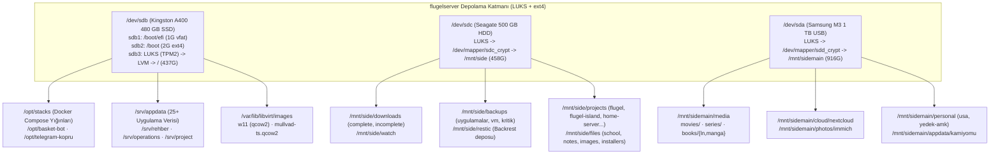

# flugelserver Üç Disk Mimarisi ve Tam Klasör Ağacı

> **Üst Harita ve Kök Bağlantılar:** [[HARITA]] · [[hafiza]] · [[kararlar]] · [[dersler]] · [[simdi]]
> **İlgili Wiki Sayfaları:** [[wiki/flugelserver-dosya-agaci-ve-diskler]] · [[wiki/flugelserver-genel-mimari]] · [[wiki/flugelserver-yedekleme-ve-otomasyon]] · [[wiki/repo-home-server]]
> **İlgili Notlar:** [[notlar/docker-uygulama-baglanti-topolojisi]] · [[notlar/sunucu-yedekleme-ve-systemd-otomasyonlari]] · [[notlar/sunucu-dizi-ve-film-arsivi-envanteri]] · [[notlar/sunucu-anime-manga-ve-rezero-arsivi]] · [[notlar/sanal-makineler-w11-gpu-ve-moonlight]]
> **İlgili Projeler:** [[projeler/flugelserver-ev-sunucusu]] · [[projeler/ikinci-beyin-kurulumu]]

---

## 1. Üç Fiziksel Disk ve LUKS Şifreleme Mimarisi

`flugelserver` (AMD Ryzen 5 2600X, 16 GB RAM, GTX 1660 Ti 6 GB, Ubuntu 26.04.1 LTS, Kernel `7.0.0-38-generic`) üzerinde tüm depolama birimleri **LUKS** ile şifrelenmiştir ve **FHS (Filesystem Hierarchy Standard)** + `lower-kebab-case` dizin adlandırma standardına (`2026-10-20` itibarıyla) geçirilmiştir.

| Bağlama Noktası | Fiziksel Aygıt / Mapper | Model ve Tür | Kapasite / Kullanım (11.11.2026) | Şifreleme & Açılış | Temel Görevi |
| :--- | :--- | :--- | :--- | :--- | :--- |
| `/` | `/dev/sdb3` → `dm_crypt-0` → `/dev/mapper/ubuntu--vg-ubuntu--lv` | Kingston A400 (`SA400S3`) 480 GB SATA SSD | `437G` Toplam / `177G–181G` Kullanılan (`%43-%44`) / `238G–242G` Boş | LUKS + LVM2 (`clevis-tpm2` ile otomatik açılır, `allow-discards` ve haftalık `fstrim.timer` aktif) | İşletim sistemi, Docker imajları, `/opt/stacks` compose tanımları, `/srv/appdata` uygulama veritabanları/ayarları, `/var/lib/libvirt/images` KVM VM diskleri |
| `/mnt/side` | `/dev/sdc` → `/dev/mapper/sdc_crypt` | Seagate 500 GB SATA HDD (`ext4`) | `458G` Toplam / `295G` Kullanılan (`%68`) / `140G` Boş | LUKS (`crypttab` + `nofail`, `noatime,commit=60`) | Transmission torrent indirmeleri (`downloads/`), tüm yedeklerin birincil kopyası (`backups/` ve `restic/`), kişisel arşiv (`files/`), yazılım projeleri (`projects/`) |
| `/mnt/sidemain` | `/dev/sda` → `/dev/mapper/sdd_crypt` *(mapper adı tarihsel olarak `sdd_crypt` kalmıştır)* | Samsung M3 1 TB Harici USB 3.0 HDD (`ext4`) | `916G` Toplam / `764G` Kullanılan (`%85`) / `143G` Boş | LUKS (`crypttab` + `nofail`, `noatime,commit=60`) | Ana medya arşivi (`media/movies`, `media/series`, `media/books`), Immich fotoğraf kütüphanesi (`photos/immich`), Nextcloud bulut verisi (`cloud/nextcloud`), kişisel belgeler (`personal/`) |

> **Önemli Donanım ve Performans Bulguları (`09-BILINEN-SORUNLAR.txt`):**
> - **SSD TRIM Cozumu:** Kingston A400 DRAM'siz SSD'de LUKS katmanında `discard` kapalı olduğu için yazma gecikmesi 4,7 saniyeye çıkıyordu. `2026-10-20 18:32`'de LUKS başlığına kalıcı `allow-discards` eklendi (başlık yedeği: `/srv/archive/security/luks/` ve `/mnt/side/backups/guvenlik/`), LVM tablosu yenilendi ve ilk `fstrim /` komutuyla **209,7 GiB** alan kırpıldı.
> - **Mapper Adı Uyarısı:** `/dev/mapper/sdd_crypt` güncel sistemde fiziksel `/dev/sda` USB diski üzerindedir; disk işlemlerinde her zaman `lsblk` ve UUID kontrol edilmelidir.
> - **Disk Koruması:** `hd-idle` ve `disk-keepalive.service` ile harici disklerin uyku döngüsü yönetilir; `/usr/local/sbin/disk-koruyucu.sh` 10 dakikada bir SMART özniteliklerini (ID 5, 187, 197, 198) ve çekirdek I/O hatalarını denetler.



---

## 2. Sistem Diski (`/`) Dizin Yapısı ve FHS Standartları

20 Ekim 2026 FHS düzenlemesiyle kök dizindeki dağınık klasörler (`/arrapps`, `/W11`, `/downloads`) standart FHS yollarına taşınmış, geriye dönük uyumluluk için sembolik bağlar bırakılmıştır (`/arrapps -> srv/appdata`).

### 2.1. `/srv` Dizin Ağacı
```text
/srv
├── appdata/                         # Tüm Docker konteynerlerinin kalıcı yapılandırma ve veritabanı dizini
│   ├── _kaldirildi-20261104/        # Kaldırılan servislerin arşivlenen appdata verileri
│   ├── _kaldirildi-20261105/
│   ├── adguard/                     # AdGuard Home (work/, conf/)
│   ├── ai-library/                  # Yerel AI bilgi kütüphanesi
│   ├── alertmanager/                # Prometheus Alertmanager verisi
│   ├── backrest/                    # Backrest (data/, config/, cache/, rclone/)
│   ├── bazarr/                      # Bazarr altyazı yapılandırması
│   ├── dozzle/                      # Dozzle konteyner günlük izleyici verisi
│   ├── filebrowser/                 # FileBrowser veritabanı ve ayarları
│   ├── gmail-notifier/              # Gmail bildirim betiği durumu
│   ├── grafana/                     # Grafana panoları ve SQLite veritabanı
│   ├── guacamole/                   # Apache Guacamole PostgreSQL veritabanı (db/)
│   ├── immich/                      # Immich (postgres/ veritabanı ve model-cache/ yapay zeka modelleri)
│   ├── jackett/                     # Jackett indexer tanımları
│   ├── jellyfin/                    # Jellyfin medya sunucusu meta verileri
│   ├── kavita/                      # Kavita EPUB/PDF/okuma veritabanı
│   ├── komga/                       # Komga çizgi roman/manga veritabanı
│   ├── nextcloud/                   # Nextcloud uygulama ve PHP-FPM yapılandırması
│   ├── nextcloud-db/                # Nextcloud PostgreSQL 17 veritabanı
│   ├── ollama/                      # Ollama dil modelleri (qwen3.5:4b)
│   ├── plex/                        # Plex Media Server kütüphane meta verileri
│   ├── prometheus/                  # Prometheus TSDB (180 gün / 8 GB saklama)
│   ├── prowlarr/                    # Prowlarr merkezi indexer veritabanı
│   ├── radarr/                      # Radarr film takip veritabanı
│   ├── sonarr/                      # Sonarr dizi/anime takip veritabanı
│   ├── suwayomi/                    # Suwayomi (Tachidesk) manga sunucu ayarları
│   ├── transmission/                # Transmission torrent istemci ayarları
│   └── uptime-kuma/                 # Uptime Kuma izleme veritabanı
├── archive/                         # Aktif kullanılmayan ancak korunan arşivler
│   ├── appdata/
│   ├── backups/                     # Eski manuel yedekler (nextcloud-2026-05-14, immich-db-2026-10-07)
│   ├── pc-yedekleri/                # PC'den alınan eski yedekler (pc-ev, pc-projeler)
│   ├── security/                    # LUKS başlık yedeği (luks-sda3-header.img, izin 700 root)
│   └── stacks/                      # Eski compose dosyaları
├── backups/
│   └── current/uygulamalar/         # Uygulama yedeklerinin SSD üzerindeki güncel kopyası (%90 disk sınırında atlanır)
├── dev/                             # Sunucu üzeri geliştirme çalışma alanı
│   ├── README.md
│   ├── archive/
│   ├── artifacts/
│   ├── docs/                        # INFRASTRUCTURE.md vb.
│   ├── projects/
│   ├── tools/
│   └── workspaces/
├── geri-yukleme/                    # Backrest / Restic geri yükleme test hedefi
│   └── test-20261105-1813/
├── operations/                      # Sistem operasyon, denetim ve geri dönüş kayıtları
│   ├── ai-context/                  # Yapay zeka ajanları için bağlam dosyaları
│   ├── audit/
│   ├── changes/                     # Her sistem değişikliğinin tarihli (2026-10-20-*) geri dönüş kopyası (onceki/)
│   ├── history/
│   ├── inventory/
│   └── sunucu-kilavuzu/
├── project/                         # Windows VM içindeki Eclipse projelerinin Samba/robocopy yedeği
│   ├── README.txt
│   ├── docs/                        # ABIMIN-PLANI-YOL-HARITASI.md
│   ├── gelen/                       # Windows VM'den 15 dakikada bir gelen robocopy /MIR kopyası
│   ├── surumler/                    # Her gece 02:30'da proje-surum.timer ile alınan hardlink sürümleri (30 gün)
│   └── windows/                     # eclipse-esitle-kur.ps1 kurulum betiği
├── rehber/                          # Canlı sunucu dokümantasyonu (her sabah 06:00'da rehber-guncelle.py ile yenilenir)
│   ├── 00-OKU-BENI.txt .. 11-KAYNAK-KORUMA-2026-10-21.txt
│   └── komutlar/                    # sifre-sifirla.sh vb. yardımcı betikler
└── yedek/                           # Dönemsel tam yapılandırma ve güvenlik yaması yedekleri
    ├── 2026-10-21-claude/
    ├── 2026-10-21-codex/
    ├── guvenlik-yamasi-20261025-2002/
    └── uptime-kuma-v1-20261025-201200.tar.gz
```

### 2.2. `/opt` Dizin Ağacı
```text
/opt
├── Antigravity/                     # Antigravity kurulum dizini
├── Mullvad VPN/                     # Mullvad VPN istemci dosyaları
├── basket-bot/                      # TBF / Assignr basketbol hakem, anime takip ve IMDb puan botları
│   ├── anime_takip.py
│   ├── ayar.json
│   ├── basket_bot.py
│   └── imdb_puan.py
├── containerd/
├── dockge/                          # Dockge compose yönetim verisi
├── filebrowser/                     # FileBrowser compose ve db
├── flugel-archives/                 # Basketbol arşiv verileri
├── flugel-cyberlab/                 # FLUGEL Cyber Range (current/, releases/)
├── gemini-cli/
├── nvidia/                          # Nsight Compute / Systems
├── scripts/                         # gmail-auth.py, gmail-notifier.py
├── stacks/                          # Tüm Docker Compose yığınları (Git ile sürümlenir)
│   ├── _bakim/
│   ├── _kaldirildi-20261104/
│   ├── _kaldirildi-20261105/
│   ├── adguard/
│   ├── backrest/
│   ├── bazarr/
│   ├── cup/
│   ├── dozzle/
│   ├── flaresolverr/
│   ├── giris/
│   ├── gluetun/
│   ├── guacamole/
│   ├── immich_server/
│   ├── izleme/                      # Prometheus + Alertmanager + node-exporter + Grafana
│   ├── jackett/
│   ├── jellyfin/
│   ├── kavita/
│   ├── komga/
│   ├── nextcloud/
│   ├── ollama/
│   ├── panel/                       # Homepage + gundem-botu + flugel-akis
│   ├── plex/
│   ├── prowlarr/
│   ├── radarr/
│   ├── sonarr/
│   ├── subgen/
│   ├── suwayomi/
│   ├── transmission2/
│   ├── tsidp/
│   ├── uptime-kuma/
│   └── yukle/
└── telegram-kopru/                  # Telegram sunucu bildirim ve AI ajan köprüsü (kopru.py)
```

### 2.3. `/home/flugel` Dizin Ağacı (Sunucu)
```text
/home/flugel
├── Arc 9 - Light of a Nameless Star-20260519T215221Z-3-001.zip.bak
├── adguard/
├── duduk-server/                    # Düdük hakem uygulaması sunucu arka ucu (Docker: 127.0.0.1:18420)
│   ├── Dockerfile
│   ├── README.md
│   ├── app-debug.apk
│   ├── app.py
│   ├── data/
│   ├── docker-compose.yml
│   └── ekranlar/
├── durdurulan-konteynerler-20261104.txt
├── flugel-reader-updates/           # Koharia Reader (Flugel Manga) imzalı APK güncelleme sunucusu (latest.json, releases/)
├── gokalpgoksu/                     # islem-kaydi.log
├── indirme-rezero/                  # Re:Zero Novel geçici indirme alanı
├── izleme-kurulum/                  # Prometheus/Grafana/Backrest ve gece-yedek/db-dokum birim şablonları
├── sistem-bakim/                    # Bakım betikleri (kaynak-siniri.py, komga-adlar.py, komga-bolumler.py, vmroot.sh...)
├── suwayomi-disk-guard.sh
├── taildrop-nextcloud-yedek-20261106/
├── tailscale-serve-yedek-20261105-061248.json
├── work/                            # Android SDK, Gradle ve Koharia Reader derleme çalışma alanı
│   ├── akis-app/
│   ├── android-sdk/
│   ├── koharia-public/              # Git deposu (Flugel Manga public/personal build)
│   ├── koharia-reader/              # Git deposu (Koharia Reader kaynak kodu)
│   ├── ln-kategoriler-20261102T145804Z/
│   ├── mega-rezero-20261102/
│   ├── organize_ln_languages.py
│   └── rezero-organize-20261102/
└── yedek/                           # bookstack-users SQL ve immich-system-config JSON yedekleri
```

---

## 3. Yan Disk (`/mnt/side`) ve Ana Veri Diski (`/mnt/sidemain`) Klasör Ağacı

### 3.1. `/mnt/side` (Seagate 500 GB — İndirmeler, Yedekler, Projeler)
```text
/mnt/side
├── arsiv/
├── backups/                         # Tüm sunucu yedeklerinin ana merkezi (eski bağ: yedek -> backups)
│   ├── claude-20261031-claude/
│   ├── guvenlik/                    # LUKS başlık yedekleri
│   ├── kritik/                      # kritik-yedek.sh aynası (immich, nextcloud, appdata, stacks, etc, veritabanlari/, .silinenler/)
│   ├── rezero-duzen-20261103-162949.json
│   ├── rezero-duzen-20261103-wn-duzeltme.txt
│   ├── rezero-ln-20261103/          # Re:Zero Light Novel düzenleme öncesi tam yedek
│   ├── uygulamalar/                 # uygulama-yedek.py gece arşivleri (<uygulama>/<uygulama>_<tarih>.tar.zst, 3 sürüm)
│   └── vm/                          # Sanal makine qcow2 + NVRAM + TPM yedekleri (w11/, mullvad-ts/)
├── downloads/                       # Transmission indirme hedefi (Sonarr ve Radarr buradan okur)
│   ├── complete/                    # Tamamlanan indirmeler (radarr/, tv-sonarr/)
│   └── incomplete/                  # Devam eden indirmeler
├── files/                           # Kişisel dosyalar (eski kök dosyaları ve ödev/ birleşimi)
│   ├── images/
│   ├── installers/                  # FLUGEL.apk, NxtPanel-development.zip
│   ├── notes/                       # FLUGEL-*.md, Notlar.md, abim.txt
│   └── school/                      # Üniversite ödev ve ders PDF'leri
├── karantina/                       # ClamAV (virus-tarama.sh) ve torrent-bekci.sh karantina dizini
├── projects/                        # Tüm yazılım projeleri ve çalışma alanları
│   ├── NxtPanel-development/
│   ├── flugel/                      # Ana sunucu ve GNOME Island monorepo
│   ├── flugel-cyber-lab/            # Siber güvenlik eğitim platformu (FastAPI + React)
│   ├── flugel-island/               # GNOME Shell Dynamic Island eklentisi (v3.1 Quiet Orbit)
│   ├── flugel-manga/                # Koharia Reader / Flugel Manga deposu
│   ├── flugel-sunucu-app/
│   ├── home-server/                 # Sunucu altyapı ve dokümantasyon deposu
│   ├── island-adaylar/
│   ├── weekly-task/
│   ├── weekly-tasks/
│   └── workspaces/                  # eclipse-workspace, git-workspace, myworkspace, codex
├── restic/                          # Backrest (restic) şifreli yedek deposu
├── watch/                           # Transmission otomatik .torrent izleme klasörü
└── yedek -> backups                 # Geriye dönük uyumluluk sembolik bağı
```

### 3.2. `/mnt/sidemain` (Samsung M3 1 TB — Medya, Bulut, Fotoğraf, Kitap)
```text
/mnt/sidemain
├── appdata/
│   └── kamiyomu/                    # Kamiyomu manga indirme veritabanı ve günlükleri
├── backups/
│   └── current/uygulamalar/         # Uygulama yedeklerinin ikincil güncel kopyası
├── cloud/
│   └── nextcloud/                   # Nextcloud kullanıcı dosyaları (flugel/files/...) ve owncloud.db
├── media/
│   ├── books/                       # Komga (/data) ve Kavita (/data/books) ana kütüphane kökü
│   │   ├── ln/                      # Light Novel arşivi (books/English/{Alya,ReZero}, books/Türkçe/ReZero)
│   │   └── manga/                   # Manga arşivi (43 kök seri + kamiyomu/ + suwayomi/mangas/)
│   ├── movies/                      # 42 film klasörü (Radarr, Jellyfin, Plex, Bazarr, Subgen)
│   ├── series/                      # 13 dizi/anime klasörü (Sonarr, Jellyfin, Plex, Bazarr, Subgen)
│   └── tv-recordings/               # Boş (eski tv_kayitlari)
├── personal/
│   ├── usa/                         # Kişisel evraklar
│   └── yedek-amk/                   # Kritik kişisel yedek klasörü
├── photos/
│   └── immich/                      # Immich fotoğraf ve video yüklemeleri (library/admin, upload/)
├── books -> media/books             # Uyumluluk sembolik bağı
├── immich -> photos/immich          # Uyumluluk sembolik bağı
├── kamiyomu -> appdata/kamiyomu     # Uyumluluk sembolik bağı
├── movies -> media/movies           # Uyumluluk sembolik bağı
├── nextcloud_data -> cloud/nextcloud # Uyumluluk sembolik bağı
├── series -> media/series           # Uyumluluk sembolik bağı
└── yedek amk -> personal/yedek-amk  # Uyumluluk sembolik bağı
```
