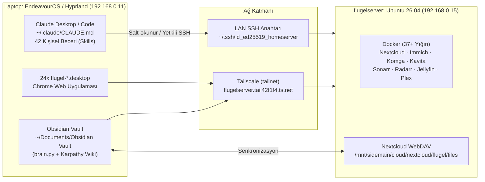

# PC (EndeavourOS / Arch Hyprland) ve Masaüstü / Yerel AI Kurulum Analizi

> **Üst Harita ve Kök Bağlantılar:** [[HARITA]] · [[hafiza]] · [[kararlar]] · [[dersler]] · [[simdi]]
> **İlgili Wiki Sayfaları:** [[wiki/pc-masaustu-hyprland-ve-gnome-araclari]] · [[wiki/repo-end4-pc]] · [[wiki/repo-gnome-island]] · [[wiki/repo-desktop-server-toolkit]] · [[wiki/ikinci-beyin-sistemi]]
> **İlgili Notlar:** [[notlar/flugelserver-uc-disk-ve-klasor-agaci]] · [[notlar/docker-uygulama-baglanti-topolojisi]] · [[notlar/docker-ag-panel-ve-altyapi-yigini]]
> **İlgili Projeler:** [[ikinci-beyin-sistemi]] · [[projeler/flugel-sunucu-ve-akis]]

---

## 1. Laptop (`PC01 / DESK01`) Donanım ve Disk Yapısı (`01-PC-ANALIZI.md`)

- **Model:** Lenovo ThinkBook 16p Gen 4 IRH (`192.168.0.11`).
- **İşlemci ve Bellek:** Intel Core i7-13700H (14 fiziksel çekirdek / 20 iş parçacığı), **32 GB RAM** + **8 GB zram swap**.
- **Hibrit Grafik (Optimus):**
  - Dahili: **Intel Iris Xe** (`renderD129`, masaüstü çizimi ve Chrome donanım video çözme).
  - Harici: **NVIDIA RTX 4060 Laptop GPU (8 GB)** (Sürücü: `615.78.08`, boşta 45°C).
- **İşletim Sistemi:** EndeavourOS (Arch Linux tabanlı), Kernel `Linux 6.18.58-1-lts`, toplam 1720 paket (21 AUR paketi).
- **Depolama (WD Blue SN5000 500 GB NVMe SSD):**
  - **Windows Bölümü:** BitLocker şifreli.
  - **Linux Bölümü (Btrfs — ~78 GB):** `50 GB` kullanılan, `27 GB` boş (`%66` doluluk). `/`, `/home`, `/var/log`, `/var/cache` aynı Btrfs dosya sisteminin alt birimleridir (subvolumes). Snapper zaman çizelgesi, Btrfs scrub ve `fstrim` zamanlayıcıları aktiftir.
  - **Ek Bölüm:** ~37 GB `ext4` bölüm (bağlı değil).

---

## 2. Hyprland (Lua) Çift Kabuk Mimarisi: `end4-pC` ve `Caelestia-AW`

PC üzerinde **Hyprland `0.56.2`** pencere yöneticisi çalışır. Standart `.conf` yerine **Lua yapılandırması** kullanılır:
- **Ana Yapılandırma:** `~/.config/hypr/hyprland.lua` ve kişisel ekler `~/.config/caelestia/hypr-user.lua` (eski `hyprland.conf` sözdizimi doğrudan uygulanmamalıdır; ör. komut çalıştırmak için `hyprctl dispatch "hl.dsp.exec_cmd(...)"` kullanılır).
- **Çift Monitör Düzeni:**
  - **Dahili Ekran (`eDP-1`):** `2560×1600 @ 60 Hz`, konum `x=0`, ölçek **`1.25` (%125)**.
  - **Harici Monitör (`DP-1` — AOC, solda):** `1920×1080 @ 60 Hz`, konum `x=-1920`, ölçek **`1.0` (%100)**.
- **Çift Quickshell Arayüzü ve Özel Sarmalayıcı Betikler (`~/.local/bin/`):**
  1. **`end4-pC` (`~/.config/quickshell/end4-pC`):** `pctrade/end4-pC` (`gok8lp/end4-pC`, commit `74813a8`) Qt uyumluluğu ve yerel entegrasyon yamalarıyla kurulu. Tercihler `~/.config/illogical-impulse/config.json` ve `presets/` altındadır.
  2. **`Caelestia` & `Caelestia-AW`:** Sistem paketleri (`shell 2.5.0`, `CLI 1.1.3`) korunurken kullanıcıya özel derlenen `Caelestia-AW` `~/.local/share/caelestia-aw/` ve `~/.config/quickshell/caelestia-aw/` altında çalışır.
  3. **Geçiş ve Yönetim Betikleri:**
     - `~/.local/bin/arayuz-sec` (`Super+Ctrl+F12`): `end4-pC` ile `Caelestia` arasında geçiş yapar, son seçimi `~/.local/state/arayuz-secimi` dosyasında saklar.
     - `~/.local/bin/arayuz-ayarlari` (`Super+Ctrl+F11`): Etkin arayüzün ayar panelini açar.
     - `~/.local/bin/hareketli-duvar` (`Super+Ctrl+F10`): Ortak resim ve video (`mpvpaper` kullanıcı systemd servisi ile) duvar kağıdı seçici.
     - `~/.local/bin/caelestia`: Etkin arayüze göre AW CLI veya sistem CLI seçen sarmalayıcı.

---

## 3. Chrome Donanım Hızlandırma ve Hibrit GPU Çözümü

- **Sorun ve Kök Neden:** Hyprland'in genel ortam değişkeni olarak verdiği `LIBVA_DRIVER_NAME=nvidia`, Chrome'da videoyu RTX 4060 üzerinde çözdürüyor ancak görüntüyü çizen Intel Iris Xe kareleri içe aktaramadığı için (`eglCreateImage 0x3009`) YouTube videoları siyah/boş kalıyordu ve NVIDIA GPU gereksiz yere uyanıyordu.
- **Kalıcı Çözüm (`~/.local/bin/google-chrome-stable`):**
  - Özel başlatıcı betik NVIDIA ortam değişkenlerini temizler, `LIBVA_DRIVER_NAME=iHD` (`intel-media-driver`) atar ve `XDG_SESSION_TYPE=wayland` zorlar.
  - `~/.config/chrome-flags.conf` içine `--disable-features=AcceleratedVideoDecodeLinuxZeroCopyGL` eklenerek X/Twitter kaydırma sırasında oluşan eski kare titremesi giderilmiştir.
  - Sistemdeki **24 adet `flugel-*.desktop`** sunucu web uygulaması kısayolu ve yerel Chrome başlatıcısı bu sarmalayıcı betiği kullanır (`~/.local/share/chrome-launcher-yedek-20261102-134555.tgz`).
  - Sonuç: Chrome `156.0.8078.47` altında H.264, VP9 ve AV1 (4K dahil) videolar tamamen Intel Iris Xe üzerinde donanımsal olarak çözülür, RTX 4060 uykuda kalır.

---

## 4. Ubuntu / GNOME Araçları ve FLUGEL Island Ekosistemi

PC ve sunucu ekosisteminde geliştirilen masaüstü projeleri (`raw/github/` ve `/mnt/side/projects/`):
- **FLUGEL Island (`gok8lp/gnome-island`, v3.1 *Quiet Orbit*):**
  - GNOME Shell için geliştirilen Dynamic Island eklentisi (164+ uçtan uca test).
  - Sunucudaki `flugel-akis` (`/api/island` <- `island-veri.py`) ile konuşarak canlı sunucu metriklerini, **Düdük / basket-bot** maçlarını, CS2 harita durumunu, medya oynatıcıyı (üç fazlı 2fps eşitleyici, 2px ilerleme çizgisi), pano geçmişini, oyun indirimlerini (PS Plus / Epic) ve bildirimleri (canlı etkinlik susturma + önceliklendirme ile) üst barda gösterir.
- **Diğer Linux Masaüstü Araçları:**
  - `gok8lp/gnome-pip-konum`: GNOME Picture-in-Picture pencere konumlandırma ve stres testi aracı.
  - `gok8lp/clipline-linux`: Linux pano (clipboard) yönetim aracı.
  - `gok8lp/headset-surround-linux`: PipeWire / WirePlumber 7.1 sanal çevresel ses yapılandırması.
  - `gok8lp/k380s-ubuntu-fn`: Logitech K380s klavye Fn tuşu kalıcı yapılandırması.
  - `gok8lp/chrome-orta-tik-kaydirma`: Linux Chrome otomatik kaydırma (autoscroll) eklentisi.

---

## 5. PC ↔ flugelserver Bağlantı Haritası ve Claude Code Kurulumu (`04`..`09`)

### 5.1. Claude Code Entegrasyonu ve 42 Beceri (`07`, `08`, `09-MATTPOCOCK-TAM-KURULUM.md`)
- **Kalıcı Sistem Bilgisi:** `~/.claude/knowledge/flugel-sistem/` altında `01-PC-ANALIZI.md`..`09-MATTPOCOCK-TAM-KURULUM.md` dosyaları kurulu olup `~/.claude/CLAUDE.md` tarafından otomatik içe aktarılır (`permissions.defaultMode=auto`).
- **4 Özel Homelab/Masaüstü Becerisi (`~/.claude/skills/`):**
  1. `/homelab-kontrol`: PC ve `flugelserver` disk, RAM, systemd ve Docker sağlık özeti.
  2. `/homelab-degisiklik`: Yetkili servis değişikliği (önce/sonra kontrolü, tarihli yedek ve geri dönüş planı).
  3. `/masaustu-dogrula`: Hyprland/Quickshell kısayol, panel, ölçek ve preset davranışını gerçek ekranla doğrulama.
  4. `/hata-teshis`: Gerçek belirtiyi yakalayan test veya ölçümle arıza teşhisi.
- **Matt Pocock 38 Beceri Kurulumu (`59db609e`):**
  - Kaynak depo `~/.local/share/claude-skill-sources/mattpocock-skills` altında saklanır; **20 engineering** (`/tdd`, `/code-review`, `/diagnosing-bugs`, `/implement`, `/to-spec`, `/codebase-design` vb.), **7 productivity** (`/grill-me`, `/handoff`, `/teach`, `/writing-for-agents` vb.), **4 misc** ve **7 in-progress** becerisiyle birlikte toplam **42 beceri** yerel Claude Code oturumlarında aktiftir.
