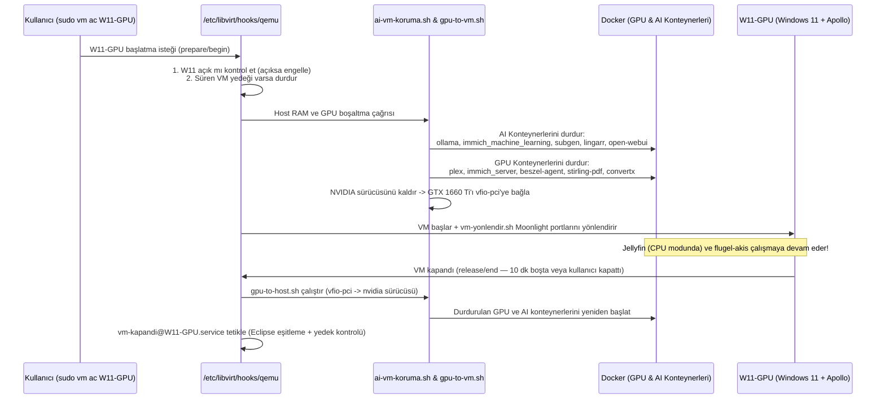

# KVM Sanal Makineler, W11 / W11-GPU Ortak Disk Kuralı, GTX 1660 Ti Passthrough ve Moonlight

> **Üst Harita ve Kök Bağlantılar:** [[HARITA]] · [[hafiza]] · [[kararlar]] · [[dersler]] · [[simdi]]
> **İlgili Wiki Sayfaları:** [[wiki/flugelserver-sanal-makineler-ve-gpu]] · [[wiki/flugelserver-genel-mimari]] · [[wiki/flugelserver-yedekleme-ve-otomasyon]] · [[wiki/repo-home-server]]
> **İlgili Notlar:** [[notlar/flugelserver-uc-disk-ve-klasor-agaci]] · [[notlar/sunucu-yedekleme-ve-systemd-otomasyonlari]] · [[notlar/docker-ag-panel-ve-altyapi-yigini]] · [[notlar/docker-bulut-ve-fotograf-yigini]]
> **İlgili Projeler:** [[projeler/flugel-sunucu-ve-akis]]

---

## 1. Tanımlı KVM Sanal Makineleri (`libvirt` / QEMU)

`flugelserver` üzerinde üç sanal makine tanımı mevcuttur. Sanal makine diskleri sistem SSD'sinde `/var/lib/libvirt/images/` altında tutulur ve sanal makineler `default` NAT ağı (`192.168.122.0/24`) üzerinde sabit DHCP IP adresleriyle çalışır.

| VM Adı | İşletim Sistemi | Donanım (vCPU / RAM / GPU) | Disk Yolu ve Kapasite | Otomatik Başlatma | Erişim Yöntemi |
| :--- | :--- | :--- | :--- | :--- | :--- |
| **`W11-GPU`** | Windows 11 Pro (BitLocker + sanal TPM) | **8 vCPU**, **4 GB RAM**, **NVIDIA GTX 1660 Ti (6 GB)** doğrudan PCIe Passthrough (`vfio-pci`) | `/var/lib/libvirt/images/w11` (`qcow2`, 100 GB sanal — **W11 ile ortak disk**) | Kapalı (`autostart` kapalı; yalnız `sudo vm ac W11-GPU` ile) | **Apollo / Moonlight** (PC ve telefon) + Cockpit (`:39443`) |
| **`W11`** | Windows 11 Pro (BitLocker + sanal TPM) | **4 vCPU**, **4 GB RAM**, **GPU'suz** (sanal ekran kartı) | `/var/lib/libvirt/images/w11` (**W11-GPU ile birebir aynı disk**) | Kapalı (`sudo vm ac W11`) | RDP / Guacamole / VNC |
| **`mullvad-ts`** | Ubuntu 24.04 LTS (XFCE — Yaru Dark) | **4 vCPU**, **4 GB RAM**, GPU'suz | `/var/lib/libvirt/images/mullvad-ts.qcow2` (30 GB) | İsteğe bağlı (`sudo vm ac mullvad-ts`) | Apache Guacamole RDP (`masaustu.gokalpgoksu.com` / `:8097`), SSH |

---

## 2. Altın Kural: `W11` ve `W11-GPU` Ortak Disk Koruması

> **Altın Kural (`00-OKU-BENI.txt` & `05-SANAL-MAKINELER.txt`):**
> `W11` ve `W11-GPU` **AYNI Windows diskini (`/var/lib/libvirt/images/w11`)** kullanır. İkisi kesinlikle aynı anda açılamaz!

- **Libvirt Kancası Engeli (`/etc/libvirt/hooks/qemu`):** Biri açıkken diğerini başlatma girişimi libvirt kancası tarafından anında reddedilir (disk bozulmasını / NTFS ve BitLocker çökmesini önler).
- **Neden İki Ayrı Tanım Var?**
  - Oyun veya GPU gerektiren bir iş yapılacağında `W11-GPU` açılır ve GTX 1660 Ti sunucudan alınıp Windows'a verilir.
  - Sunucudaki yapay zeka (`ollama`, `immich_machine_learning`, `subgen`) ve `plex` servislerini durdurmadan yalnız Windows içindeki Eclipse / ofis dosyalarına bakmak gerektiğinde GPU'suz `W11` açılır.
- **Yönetim Komutları (`/usr/local/bin/vm`):**
  ```bash
  sudo vm durum                 # Sanal makinelerin açık/kapalı durumunu gösterir
  sudo vm ac W11-GPU            # W11-GPU'yu başlatır (GPU'yu VM'ye devreder)
  sudo vm kapat W11-GPU         # Temiz ACPI kapatma gönderir
  sudo vm yedekler              # Mevcut VM yedeklerini listeler
  sudo vm yedek W11-GPU         # Elle VM yedeği alır
  sudo vm geri-yukle w11 <tarih> --evet
  ```

---

## 3. GTX 1660 Ti GPU Passthrough Döngüsü ve RAM Koruması

`W11-GPU` başlatıldığında ve kapatıldığında `/etc/libvirt/hooks/qemu`, `/usr/local/sbin/ai-vm-koruma.sh`, `/usr/local/bin/gpu-to-vm.sh` ve `/usr/local/bin/gpu-to-host.sh` betikleri tam otomatik bir döngü işletir:



### 3.1. Kaynak ve OOM Koruması (`11-KAYNAK-KORUMA-2026-10-21.txt`)
- 21 Ekim 2026'da `W11` QEMU süreci global OOM (Out of Memory) nedeniyle çekirdek tarafından öldürüldüğü için `/usr/local/sbin/ai-vm-koruma.sh` (`ai-vm-koruma.timer`, 10 saniyede bir + libvirt hook) devreye alınmıştır:
  - Herhangi bir VM açılırken veya çalışırken `open-webui`, `lingarr`, `immich_machine_learning`, `subgen` ve `ollama` durdurulur (`flugel-akis` açık kalır, yalnız AI çeviri/puanlama bekler).
  - Tüm VM'ler kapalı olsa dahi `MemAvailable < 2500 MB` olursa AI konteynerleri durdurulur; `MemAvailable >= 4000 MB` olduğunda yalnız koruma betiğinin durdurduğu konteynerler yeniden başlatılır.

### 3.2. Apollo ve Moonlight Oyun/Masaüstü Akışı
- `W11-GPU` içinde **Apollo** (Sunshine tabanlı düşük gecikmeli ekran/oyun akış sunucusu) çalışır.
- Libvirt kancası VM açıldığında `/usr/local/sbin/vm-yonlendir.sh` betiğini çağırarak sunucuya gelen **Moonlight** portlarını `192.168.122.0/24` ağındaki `W11-GPU` IP adresine yönlendirir; PC (Arch/Hyprland) ve Android telefondaki Moonlight istemcisiyle doğrudan GTX 1660 Ti hızlandırmalı masaüstüne bağlanılır.

---

## 4. 10 Dakika Boşta Kapatma Kuralı (`vm-bosta-kapat.py`)

`vm-bosta-kapat.timer` her dakika çalışarak açık olan sanal makineleri denetler (`/etc/vm-yonetim.conf`, günlük: `/var/log/vm-yonetim.log`):

1. **Kullanım Belirtisi Ölçütleri:**
   - Dakikada **$\ge 256\text{ KiB}$** ağ trafiği (Moonlight akışı, RDP, dosya indirme), **VEYA**
   - Dakikada **$\ge 32\text{ MiB}$** disk okuma/yazma, **VEYA**
   - Bağlı aktif bir VNC/konsol ya da sunucudan VM'ye açık SSH/RDP/Guacamole bağlantısı (`2026-10-20` güncellemesi).
   - *Not:* Donmuş bir Windows çekirdeği boşa döndürebildiği için **CPU kullanımı bilerek etkinlik sayılmaz**.
2. **Temiz Kapatma ve Donma Koruması:**
   - **10 dakika** boyunca hiçbir kullanım belirtisi yoksa Windows'a ACPI güç düğmesi sinyaliyle **temiz kapatma** gönderilir.
   - 5 dakika içinde kapanmazsa ikinci ACPI sinyali gönderilir; **8 dakika** sonunda hâlâ açık ve tamamen etkinliksizse (donmuşsa) zorla kapatılır ve Telegram bildirimi gönderilir.
   - Eğer kapanış sırasında yoğun disk yazımı varsa (Windows Update kuruluyorsa) zorla kapatılmaz, 30 dakika sonra bildirim gönderilir.
3. **Neden "Kaydet ve Kapat" (Hibernate/Save) Yok?**
   - GTX 1660 Ti doğrudan PCIe passthrough ile verildiği için libvirt'in RAM durumunu diske kaydetme (`virsh ManagedSave`) özelliği donanım durumunu geri yükleyemez.

---

## 5. VM Yedekleri ve Eclipse Projeleri Eşitlemesi (`/srv/project`)

- **VM Geri Dönüş Yedekleri (`/mnt/side/backups/vm/<disk-seti>/<tarih>/`):**
  - `disk.qcow2` (zstd sıkıştırmalı), VM XML tanımları, UEFI NVRAM ve **sanal TPM durumu** (Windows `C:` diski BitLocker şifreli olduğu ve anahtarı sanal TPM'de durduğu için TPM yedeği hayati önemdedir) birlikte yedeklenir.
  - `/mnt/side` diskinde yer korumak için `/etc/vm-yonetim.conf` içinde `YEDEK_HARIC="w11"` ayarlanarak otomatik 50 GB'lık W11 yedeği kapatılmıştır; istenildiğinde `sudo vm yedek W11-GPU` ile elle alınır.
- **Eclipse Projeleri Eşitlemesi (`C:\Users\<kullanıcı>\eclipse-workspace` → `/srv/project`):**
  - Windows diski BitLocker ile şifreli olduğundan sunucu diski doğrudan bağlayıp okuyamaz.
  - Bunun yerine Windows içinden `\\192.168.122.1\project\windows\eclipse-esitle-kur.ps1` çalıştırılarak her 15 dakikada bir ve oturum açılışında `robocopy /MIR` ile projeler `/srv/project/gelen/` altına aktarılır; sunucuda `proje-surum.timer` her gece `02:30`'da değişiklik varsa `/srv/project/surumler/<tarih>` altında hardlink sürümü (30 adet) oluşturur.
- **`mullvad-ts` (Ubuntu 24.04 XFCE) Özel Davranışı:**
  - `flugel-tek-oturum.sh` (PAM `pam_exec`): Aynı anda hem yerel ekran (`lightdm`) hem web (`xrdp` / Guacamole) oturumu açılırsa diğer oturumdaki Eclipse'e "tümünü kaydet" gönderip kapatır.
  - `flugel-bosta.timer`: 15 dakika fare/klavye hareketi yoksa Eclipse'i kaydedip oturumu kapatır (VM ve VPN açık kalır).
