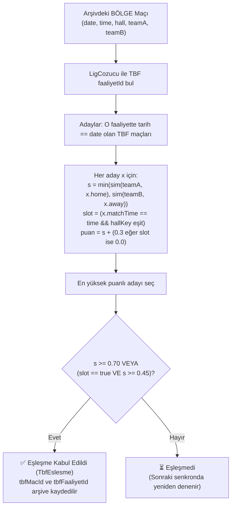

# 🧠 02 — TBF Maç ve Lig Eşleştirme Algoritması

⬅️ **Üst Merkez:** [[00 - Düdük MOC (Ana Merkez)]]
➡️ **İlgili Modüller:** [[01 - Veri Kaynakları ve API Analizi]] · [[03 - Yerel Arşiv, Birleştirme ve Değişiklik Tespiti]] · [[2026-2027 Ankara Lig Eşleşme Tablosu]]

> [!IMPORTANT] Neden Bulanık Eşleştirme Gerekiyor?
> - `ankarabasket.org.tr` ana sayfasındaki `days` JSON verisi `code == matchNumber` taşıdığı için son 2 günün `BÖLGE` maçlarını doğrudan bağlar.
> - Ancak 2 günlük pencereden eski maçların skorları ve tüm sezonun resmi sonuçları yalnızca **TBF WebAPI**'de (`get-all-matches-for-filter`) bulunur ve **TBF kayıtlarında `assignr` `matchNumber` alanı yoktur** (TBF kendi `matchId: 350958` ve `matchCode: "BRZ4933"` değerlerini kullanır).
> - Üstelik `assignr` ile TBF arasındaki takım ve salon adlarının **192 maçtan yalnızca 5'inde birebir aynı yazıldığı** tespit edilmiştir!

---

## 🔍 1. Gerçek Yazım Farkları Analizi (`assignr` ↔ `TBF`)

11 Kasım 2026 verisi üzerinde yapılan karşılaştırmada iki sistem arasındaki tipik yazım farkları:

| Kategori | `assignr` Yazımı | `TBF WebAPI` Yazımı | Farkın Nedeni |
|---|---|---|---|
| **Kısaltma / Ek Farkı** | `ANKARA MAGIC HANDS SK` | `ANKARA MAGIC HANDS` | Sonda `SK` / `SPOR` olup olmaması |
| **Türkçe İ/I Farkı** | `GENÇ MAGIC HANDS SK (A)` | `GENÇ MAGİC HANDS (A)` | İngilizce sözcükte `I` ↔ `İ` dönüşümü |
| **Boşluk Kayması** | `SPORTS A ACADEMY SK (B)` | `SPORTSA ACADEMY  (B)` | Sözcük birleşmesi ve çift boşluk |
| **İl Öneki Düşmesi** | `ANKARA DİNAMİK SK` | `DİNAMİK SPOR` | `ANKARA` sözcüğü ve `SK` ↔ `SPOR` |
| **Bitişik Yazım** | `ANKARA MAVİ BİRLİK SK` | `MAVİBİRLİK` | Boşluksuz birleştirme |
| **Bitişik `-SPOR` Eki** | `OGM ORMAN SK (B)`<br>`BAŞKENT ANKA SK` | `OGM ORMANSPOR (B)`<br>`BAŞKENT ANKASPOR` | Kök sözcüğe bitişik `SPOR` soneki |
| **Akademi / Takma Ad** | `GB ACADEMY SK (B)` | `GLOBAL BASKETBALL ACADEMY SPOR (B)` | `GB` kısaltması ve `BASKETBOL`/`BASKETBALL` |
| **Sözcük Sırası** | `TÜRK TELEKOM ANKARA SK` | `ANKARA TÜRK TELEKOM` | Ters sözcük dizilimi |
| **Uzun Okul/Vakıf Adı** | `ANKARA ÜNİVERSİTESİ GELİŞTİRME VAKFI ÖZEL OKULLARI SK` | `ANKARA ÜNİVERİTESİ GEL. VAK. Ö.O. SK` | Noktalı kısaltma + TBF'de yazım hatası (`ÜNİVERİTESİ`) |
| **Takım Soneki Eksikliği** | `ERYAMAN YILDIZLARI BASKETBOL SK` | `ERYAMAN YILDIZLARI  (B)` | Bir tarafta `(B)` soneki unutulmuş |
| **Salon Adı Farkları** | `MEB SPOR SALONU`<br>`SİNCAN SPOR KOMPLEKSİ`<br>`ANKARA SPOR SALONU KÜÇÜK`<br>`TAHA AKGÜL SPOR SALONU` | `MEB Beşevler Spor Salonu`<br>`Sincan Spor Salonu`<br>`Ankara Spor Salonu (Küçük)`<br>`Ankara Taha Akgül Spor Salonu` | Semt adı eklenmesi (`Beşevler`), `Kompleksi` ↔ `Salonu`, parantez kullanımı |

---

## 🧬 2. Ad Normalleştirme ve Benzerlik (`Normalizasyon.kt`)

Kaynak kod: `com.flugel.duduk.data.repo.Normalizasyon` (Python referansı: `docs/samples/mac-eslesme-testi.py`).

### 2.1 Türkçe Karakter Katlama (`fold`)
> [!CAUTION] `uppercase(Locale("tr"))` Kullanmama Kuralı
> Standart `uppercase(Locale.forLanguageTag("tr"))` çağrısı küçük `i` harfini `İ`'ye çevirirken yabancı sözcüklerdeki (`MAGIC` / `MAGİC`) `I`/`İ` ayrımını korur ve eşleşmeyi bozar.
> Bunun yerine **önce** tüm `İ`, `ı`, `i` karakterleri tek tip ASCII `'I'` karakterine dönüştürülür, ardından `uppercase(Locale.ROOT)` uygulanır ve `ÇĞÖŞÜÂÎÛ` → `CGOSUAIU` tablosuyla katlanır:

```kotlin
fun fold(s: String): String {
    val b = s.replace('İ', 'I').replace('ı', 'I').replace('i', 'I').uppercase(Locale.ROOT)
    return buildString(b.length) { b.forEach { append(CEVIR[it] ?: it) } }
}
```

### 2.2 Salon Anahtarı (`salonAnahtari` / `hallKey`)
1. `fold(salon)` uygulanır ve harf/rakam dışı tüm karakterler (`[^A-Z0-9 ]`) boşluğa çevrilir.
2. Gürültü sözcükleri kümesi (`SALON_ATILAN = {"SPOR", "SALONU", "KOMPLEKSI", "ANKARA", "BESEVLER"}`) atılır.
3. Kalan sözcükler tek boşlukla birleştirilir:
   - `"MEB Beşevler Spor Salonu"` → **`"MEB"`**
   - `"MEB SPOR SALONU"` → **`"MEB"`**
   - `"ANKARA SPOR SALONU KÜÇÜK"` / `"Ankara Spor Salonu (Küçük)"` → **`"KUCUK"`**
   - `"SİNCAN SPOR KOMPLEKSİ"` / `"Sincan Spor Salonu"` → **`"SINCAN"`**
   - `"Ankara Taha Akgül Spor Salonu"` → **`"TAHA AKGUL"`**

### 2.3 Takım Anahtarı ve Sonek Ayırma (`takimAnahtari` / `teamKey`)
1. `fold(ad).trim()` uygulanır.
2. Sondaki `\(([A-Z])\)\s*$` deseniyle takım grubu soneki (`(A)`, `(B)` vb.) ayrılır (`sonek: String`).
3. Sonek çıkarıldıktan sonra kalan gövdede harf/rakam dışı karakterler boşluğa çevrilir.
4. Durak sözcükleri (`TAKIM_ATILAN = {"SK", "SPOR", "KULUBU", "GSK", "S", "K"}`) atılır.
5. Takma ad sözlüğü uygulanır: `"GB" -> "GLOBAL BASKETBALL"`, `"BASKETBOL" -> "BASKETBALL"`.
6. **Bitişik `-SPOR` Kesimi:** Uzunluğu 6 karakterden büyük olup `"SPOR"` ile biten sözcüklerin sonundaki 4 harf (`"SPOR"`) kesilir (`"ORMANSPOR"` → `"ORMAN"`, `"ANKASPOR"` → `"ANKA"`).
7. Kalan tüm parçalar **boşluksuz** birleştirilir (`"MAVI" + "BIRLIK"` → `"MAVIBIRLIK"`).

### 2.4 Takım Benzerliği (`takimBenzerligi`) ve Ratcliff/Obershelp (`oran`)
İki takım adı `(ka, sa)` ve `(kb, sb)` olarak ayrıştırıldıktan sonra:
1. **Sonek Çatışması Kontrolü:**
   - Eğer `sa != sb` ise ve **her ikisi de doluysa** (biri `(A)` takımı, diğeri `(B)` takımıysa) benzerlik doğrudan **`0.0`** döner! Böylece aynı kulübün A ve B takımlarının birbiriyle yanlış eşleşmesi %100 engellenir.
   - Eğer sonek yalnızca bir tarafta varsa (`sa != sb` ama biri boşsa, örn. `ERYAMAN YILDIZLARI` vs `ERYAMAN YILDIZLARI (B)`) **`ceza = 0.15`** uygulanır.
2. **Tam Eşitlik:** `ka == kb` ise `1.0 - ceza` döner.
3. **Ratcliff/Obershelp Oranı (`oran`):** Python `difflib.SequenceMatcher(None, ka, kb).ratio()` algoritmasının Kotlin'deki birebir karşılığıdır:
   $$\text{oran}(a, b) = \frac{2 \times M}{|a| + |b|}$$
   Burada $M$, `eslesenKarakter()` fonksiyonunun özyinelemeli olarak en uzun ortak alt diziyi (longest contiguous matching subsequence) bulup sol ve sağ kalan parçaları toplamasıyla elde edilen eşleşen karakter sayısıdır.
4. **Alt Dizi Güçlendirmesi:** Eğer `min(ka.length, kb.length) >= 4` ise ve biri diğerini içeriyorsa (`ka in kb || kb in ka`), oran en az **`0.85`** kabul edilir (`r = maxOf(r, 0.85)`).
5. Sonuç olarak `r - ceza` döndürülür.

---

## ⚙️ 3. Eşleştirme Algoritması (`TbfEslestirici.kt`)



### Puanlama Formülü ve Eşikler
- **Takım Benzerliği ($s$):** Ev sahibi ve deplasman benzerliklerinin **minimumu** alınır:
  $$s = \min\big(\text{sim}(\text{teamA}, \text{homeTeam}),\ \text{sim}(\text{teamB}, \text{awayTeam})\big)$$
- **Slot Uyumu ($\text{slot}$):** Saat (`matchTime == time`) ve normalize salon anahtarı (`salonAnahtari(salonAdi) == salonAnahtari(hall)`) birebir aynıysa $\text{slot} = 1$, değilse $0$.
- **Toplam Puan:**
  $$\text{puan} = s + 0.3 \times \text{slot}$$
- **Kabul Kriteri (`ESIK = 0.70`, `SLOT_ESIK = 0.45`):**
  - Saat veya salon değişmiş olsa bile takım benzerliği yüksekse ($s \ge 0.70$) kabul edilir.
  - Saat ve salon aynıysa ($\text{slot} = \text{true}$), uzun kısaltmalı okul/vakıf adlarını yakalamak için $s \ge 0.45$ olması yeterlidir.

### 3.1 Gerçek Veri Doğrulama Sonuçları (%97,9 İsabet, 0 Yanlış Pozitif)
`docs/samples/mac-eslesme-testi.py` ve birim testleriyle 192 oynanmış `BÖLGE` maçı üzerinde yapılan doğrulama:

| Hafta Kümesi (`BÖLGE`, tarih ≤ 9 Kasım 2026) | Toplam Maç | Slot + Takım Eşleşen | Yalnız Takım Eşleşen (Saat/Salon Farklı) | Kaçan (`MISS`) | İsabet Oranı |
|---|---|---|---|---|---|
| **7–13 Kasım 2026 Haftası** (7, 8, 9 Kasım) | 78 | 76 | 0 | 2 | **%97,4** |
| **31 Ekim – 6 Kasım 2026 Haftası** | 114 | 109 | 3 | 2 | **%98,2** |
| **TOPLAM** | **192** | **185** | **3** | **4** | **%97,9** |

- **Neden Sadece `tarih + saat + salon` Yetmez?** Takım adına bakmadan yalnız slot ile eşleştirme yapıldığında isabet 182/192'ye (%94,8) düşmekte ve aynı salonda saatleri takas edilmiş maçlar yüzünden **6 yanlış eşleşme (false positive)** oluşmaktadır.
- **Kaçan 4 Maçın Analizi:**
  - 3 maçta takımlardan biri ligden çekilmiş / ihraç edilmiştir (TBF'de başka bir tarihe `matchStatusId = 13/14` olarak yazılmış veya hiç oynanmamıştır).
  - 1 maç ise `assignr`'da çift kayıtlı olan ertelenmiş maçın (`ANK-U16E-C-2026-153`) 7 Kasım tarihli eski kaydıdır (8 Kasım'daki güncel kaydı başarıyla eşleşmiştir!).
  - **Sonuç:** Gerçekten oynanmış maçlarda **eksik veya yanlış eşleşme sıfırdır (0 false positive)**. Eşleşen 188 maç içinde en düşük benzerlik skoru `0.65` olup tamamı doğru eşleşmedir.

---

## 🗂️ 4. Dinamik Lig ve Grup Çözümleme (`LigCozucu` ve `DinamikLigKaydedici`)

Kullanıcının Gereksinim 8'de belirttiği üzere **lig listesi koda sabitlenmemiştir**.

### 4.1 `LigAdi.ayristir(lig: String)` (`Eslestirme.kt`)
`assignr` lig adını (`"U 14 ERKEK B"`, `"U 16 ERKEK ÖN ELEME"`, `"BÜYÜK ERKEK A"`) yapısal bileşenlerine ayırır:
- `onEleme`: `"ON ELEME"` içeriyor mu?
- `sev`: Son parça tek harfli `A..D` ise seviye harfi (`"A"`, `"B"`, `"C"`), değilse `null`.
- `taban`: Seviye harfi ve `"ÖN ELEME"` çıkarılmış taban ad.
- `yas`: `"U14"`, `"U16"`, `"U18"`, `"U21"` veya `"BUYUKLER"`.
- `cinsiyet`: `"ERKEK"` veya `"KADIN"` (`KIZ` ve `KADIN` → `"KADIN"`).

### 4.2 `LigCozucu.faaliyet(matchType, league)`
1. Yalnızca `matchType == "BÖLGE"` olan maçlar TBF faaliyetleriyle eşleştirilir.
2. TBF lig kataloğundaki (`TbfFaaliyet`) `yasGrubu`, `cinsiyet` ve `faaliyetAdi` içindeki `"Ön Eleme"` durumu karşılaştırılır.
3. **Özel Durum (`U 21 ERKEK`):** `assignr`'da `"U 21 ERKEK"` olarak geçen lig, TBF'de `"Ankara U21 Erkekler"` (`22334`, 0 maç) yerine **`"Ankara Ümit Erkekler"` (`22336`, 56 maç, `leagueName = "U 21 ERKEK A GRUBU"`)** altında oynanmaktadır. `LigCozucu` `yas == "U21"` olduğunda önce `"UMITLER"`, sonra `"U21"` adayını arar.

### 4.3 Puan Durumu Grubu Eşleme (`LigCozucu.puanGrubu`)
TBF puan tablosundaki `grup` adları tutarsızdır:
- Çok gruplu liglerde: `"U 14 ERKEK B LİGİ F GRUBU"`
- Tek gruplu liglerde grup harfi yoktur: `"ANKARA BÜYÜK ERKEKLER A LİGİ"`, `"U 14 KIZ A LİGİ GRUBU"`, `"U16 KIZ A"`, `"U18 KIZ A LİGİ"`, `"U18 KIZ B LİGİ"`.
- `LigCozucu.grupAnahtari(ad)`: `U\s*(\d+)` → `U$1` yapar; `ANKARA`, `LIGI`, `GRUBU` sözcüklerini atar; `ERKEKLER`→`ERKEK`, `KADINLAR`→`KADIN`, `KIZLAR`→`KIZ` dönüşümü uygular. Önce `"$lig $grup"` tam anahtarını, bulamazsa tek gruplu ligler için `"$lig"` anahtarını arar.

### 4.4 Üç Aşamalı Lig Durumu (`LigDurumu` — `Arsiv.kt`)
Her senkronizasyonda `DinamikLigKaydedici.guncelle()` arşivdeki tüm maçların `(matchType, league, grup)` üçlülerini tarar ve `Arsiv.ligler` haritasına kaydeder:
1. **`LigDurumu.ESLESTI`**: TBF'de karşılık gelen `tbfFaaliyetId` bulundu (skor ve puan durumu çekilebilir).
2. **`LigDurumu.KATALOGDA`**: Gömülü `season-teams.json` kataloğunda biliniyor ama TBF puan/skor karşılığı yok.
3. **`LigDurumu.TANINMAYAN`**: Ne TBF'de ne de gömülü katalogda karşılığı var (`OKUL`, `AGL`, `ABL`, `AA` veya yeni açılan turnuvalar). Arayüzde ayrı bir **"Tanınmayan Ligler"** listesinde açıklamasıyla gösterilir. Tam liste için bkz. [[2026-2027 Ankara Lig Eşleşme Tablosu]].
