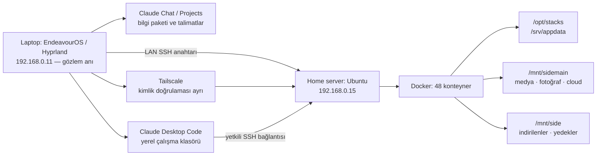

# Mimari ve servis haritası

Chat’e bilgi yüklemek ağa erişim sağlamaz. Cloud Code'un 192.168.0.15 adresine kendiliğinden yolu yoktur; bu adres yalnız yerel ağ bağlamındadır. Uzaktan kontrol için laptopta/SSH hedefinde çalışan Code oturumu veya ayrıca yetkilendirilmiş ağ ortamı gerekir. Cloud VM'ye kişisel SSH private key kopyalamak varsayılan çözüm olmamalı.

## Konteyner haritası

Portlar envanter anındaki Docker yayınlarıdır, internetten erişilebilirlik kanıtı değildir. Tam imaj ve mount eşlemeleri KONTEYNERLER.csv / ENVANTER.json içindedir.

| Konteyner | Healthcheck | Compose klasörü | Host portları |
|---|---|---|---|
| suwayomi | tanımsız | /opt/stacks/suwayomi | host portu yok / paylaşılan ağ |
| flaresolverr | tanımsız | /opt/stacks/flaresolverr | host portu yok / paylaşılan ağ |
| prowlarr | tanımsız | /opt/stacks/prowlarr | host portu yok / paylaşılan ağ |
| transmission | tanımsız | /opt/stacks/transmission2 | host portu yok / paylaşılan ağ |
| gluetun | healthy | /opt/stacks/gluetun | 127.0.0.1:4567→4567/tcp, 0.0.0.0:51413→51413/tcp, :::51413→51413/tcp, 0.0.0.0:51413→51413/udp, :::51413→51413/udp, 0.0.0.0:8889→8888/tcp, :::8889→8888/tcp, 0.0.0.0:9091→9091/tcp, :::9091→9091/tcp, 0.0.0.0:9696→9696/tcp, :::9696→9696/tcp |
| uptime-kuma | healthy | /opt/stacks/uptime-kuma | 0.0.0.0:3004→3001/tcp, :::3004→3001/tcp |
| homepage | healthy | /opt/stacks/panel | 0.0.0.0:3010→3000/tcp, :::3010→3000/tcp |
| glpi | tanımsız | /opt/stacks/it-merkezi | 0.0.0.0:8089→80/tcp, :::8089→80/tcp |
| bookstack | tanımsız | /opt/stacks/it-merkezi | 0.0.0.0:6875→80/tcp, :::6875→80/tcp |
| open-webui | healthy | /opt/stacks/ollama | 0.0.0.0:3030→8080/tcp, :::3030→8080/tcp |
| nextcloud | healthy | /opt/stacks/nextcloud | 127.0.0.1:8443→443/tcp, 192.168.0.15:8443→443/tcp |
| pairdrop | tanımsız | /opt/stacks/pairdrop | 127.0.0.1:3000→3000/tcp |
| immich_server | healthy | /opt/stacks/immich_server | 0.0.0.0:2283→2283/tcp, :::2283→2283/tcp |
| immich_machine_learning | healthy | /opt/stacks/immich_server | host portu yok / paylaşılan ağ |
| portainer | tanımsız | /opt/stacks/portainer | 0.0.0.0:9000→9000/tcp, :::9000→9000/tcp |
| kavita | tanımsız | /opt/stacks/kavita | 0.0.0.0:8295→5000/tcp, :::8295→5000/tcp |
| komga | tanımsız | /opt/stacks/komga | 0.0.0.0:8296→25600/tcp, :::8296→25600/tcp |
| beszel | tanımsız | /opt/stacks/beszel | 0.0.0.0:8090→8090/tcp, :::8090→8090/tcp |
| tsidp | tanımsız | /opt/stacks/tsidp | host portu yok / paylaşılan ağ |
| adguardhome | tanımsız | /opt/stacks/adguard | 100.86.88.1:53→53/tcp, 192.168.0.15:53→53/tcp, 100.86.88.1:53→53/udp, 192.168.0.15:53→53/udp, 0.0.0.0:8888→80/tcp, 0.0.0.0:853→853/tcp, 0.0.0.0:853→853/udp |
| ollama | healthy | /opt/stacks/ollama | 0.0.0.0:11434→11434/tcp, :::11434→11434/tcp |
| flugel-akis | healthy | /opt/stacks/panel | host portu yok / paylaşılan ağ |
| gundem-botu | healthy | /opt/stacks/panel | 0.0.0.0:3011→8090/tcp, :::3011→8090/tcp |
| cup | tanımsız | /opt/stacks/cup | 127.0.0.1:9812→8000/tcp |
| dozzle | healthy | /opt/stacks/dozzle | 127.0.0.1:9811→8080/tcp |
| it-db | healthy | /opt/stacks/it-merkezi | host portu yok / paylaşılan ağ |
| nextcloud-db | healthy | /opt/stacks/nextcloud | host portu yok / paylaşılan ağ |
| stirling-pdf | healthy | /opt/stacks/stirling-pdf | 0.0.0.0:8095→8080/tcp, :::8095→8080/tcp |
| guacamole | tanımsız | /opt/stacks/guacamole | 0.0.0.0:8097→8080/tcp, :::8097→8080/tcp |
| guac-db | healthy | /opt/stacks/guacamole | host portu yok / paylaşılan ağ |
| filebrowser | healthy | /opt/stacks/filebrowser | 127.0.0.1:8085→80/tcp |
| subgen | tanımsız | /opt/stacks/subgen | 0.0.0.0:8091→9000/tcp, :::8091→9000/tcp |
| beszel-agent | tanımsız | /opt/stacks/beszel | host portu yok / paylaşılan ağ |
| openbooks | tanımsız | /opt/stacks/openbooks | 0.0.0.0:8285→80/tcp, :::8285→80/tcp |
| plex | healthy | /opt/stacks/plex | host portu yok / paylaşılan ağ |
| bazarr | tanımsız | /opt/stacks/bazarr | 0.0.0.0:6767→6767/tcp, :::6767→6767/tcp |
| sonarr | tanımsız | /opt/stacks/sonarr | 0.0.0.0:8989→8989/tcp, :::8989→8989/tcp |
| lingarr | tanımsız | /opt/stacks/lingarr | 0.0.0.0:5575→8080/tcp, :::5575→8080/tcp |
| jellyfin | healthy | /opt/stacks/jellyfin | 0.0.0.0:8096→8096/tcp, :::8096→8096/tcp |
| radarr | tanımsız | /opt/stacks/radarr | 0.0.0.0:7878→7878/tcp, :::7878→7878/tcp |
| immich_postgres | healthy | /opt/stacks/immich_server | host portu yok / paylaşılan ağ |
| jackett | tanımsız | /opt/stacks/jackett | 0.0.0.0:9117→9117/tcp, :::9117→9117/tcp |
| convertx | tanımsız | /opt/stacks/convertx | 0.0.0.0:3003→3000/tcp, :::3003→3000/tcp |
| immich_redis | tanımsız | /opt/stacks/immich_server | host portu yok / paylaşılan ağ |
| giris | tanımsız | /opt/stacks/giris | host portu yok / paylaşılan ağ |
| guacd | healthy | /opt/stacks/guacamole | host portu yok / paylaşılan ağ |
| it-tools | tanımsız | /opt/stacks/it-tools | 0.0.0.0:8233→80/tcp, :::8233→80/tcp |
| dockge | healthy | etiket yok | 0.0.0.0:5001→5001/tcp, :::5001→5001/tcp |
