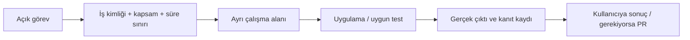

# Kaynaklardan öğrendiklerimiz ve bu kuruluma uygulananlar

> Güncelleme: Kullanıcının sonraki açık isteğiyle Matt Pocock deposunun 38 becerisinin tamamı kuruldu. Aşağıdaki beşli seçim ilk kurulumun değerlendirmesidir; güncel toplam dört özel beceriyle 42.

İnceleme: 28 Ekim 2026. Reddit yazıları kullanıcı deneyimidir; bildirilen süre/tasarruf oranları bağımsız ölçüm kabul edilmedi. Yeteneklerin yükleme ve çağırma davranışı resmi Claude belgelerinden kontrol edildi.

## 1. Homelab deneyimi: kısa kalıcı bağlam, tekrarlanabilir işler

İlk paylaşımın yararlı tarafı, altyapıyı her sohbette yeniden anlatmak yerine kalıcı bir giriş dosyası ve görev becerileri kullanması. Bizde mevcut bilgi paketi altyapıyı tutuyor; yeni beceriler kontrol ve değişiklik yöntemlerini taşıyor. Becerinin gövdesi yalnız gerektiğinde yüklenir. CLAUDE.md içine bütün bakım prosedürlerini doldurmak gerekmiyor. Reddit'teki “başarının tamamı bu dosyaya bağlı” gibi kesin ifadeleri garanti olarak almıyoruz. [Homelab paylaşımı](https://www.reddit.com/r/ClaudeAI/comments/1s9qgkj/3_weeks_of_fulltime_claude_code_on_a_homelab/)

## 2. En faydalı beceriler tartışması: az, amaçlı ve ölçülebilir

Tartışmada kısa repo haritası, test yordamı, debugging listesi ve oturum devri öne çıkıyor. Senin tekrarlanan işlerin için sağlık kontrolü, servis değişikliği, masaüstü akışı ve hata teşhisi seçildi. Çok sayıda genel beceri eklemek yerine hangi görevin hangisini çağıracağı açık yazıldı. [Beceriler tartışması](https://www.reddit.com/r/ClaudeCode/comments/1spvmtu/what_are_your_most_useful_claude_skills/)

## 3. Matt Pocock deposu: önce hatayı yakalayan sinyal

Depo incelenip bir commit'e sabitlendi; rastgele kurulum betiği veya npx çalıştırılmadı. `diagnosing-bugs` içindeki gerçek hatayı yakalayan hızlı geri bildirim fikri, bizim `hata-teshis` becerimize uyarlandı. `tdd` davranışı gerçek çağrı sınırından test etme açısından yararlı; ancak sıradan ayar değişikliği için her seferinde test tasarımını kullanıcıya onaylatmak senin tercihinle uyuşmuyor. Bağımlı becerileri çağıran geniş akışlar yerine dar kapsamlı yerel talimatlar yazıldı.

**Doğrudan kopyalanan tek upstream beceri:** `handoff`. Kaynak metni değiştirilmedi ve MIT lisansı yanında korundu. Commit manifest dosyasında. Diğer dört beceri bu PC ve sunucuya özel hazırlandı. [Kaynak depo](https://github.com/mattpocock/skills)

## 4. Gözetimsiz yazılım fabrikası: çalıştı demesine değil, çıktıya bak

Bu paylaşımda yararlı fikir, işi bir kuyruğa alma, ayrı çalışma alanı, bağımsız kontroller ve gerçek çıktı kaydı. Bizim sunucuda 48 konteyner ve dolu veri diski var; bu nedenle çoklu ajan fabrikası doğrudan medya/Nextcloud/Immich ortamıyla aynı geniş yetkilerle başlatılmamalı.

Bir sonraki aşama tasarımı: özel çalışma alanı, başlangıçta tek iş, süre/harcama sınırı, tekrar gelen isteği tanıyan iş kimliği, test sonucu ve artifact kaydı. Kod işi PR üretebilir; PR açıldığı ve CI durumu gerçekten kontrol edilir. İnceleme onayı ile deploy ayrı tutulur. Kişisel fotoğraf/cloud mount'ları ve Docker socket'i genel kod işçisine verilmez. Bu bir tasarım önerisidir; iş kuyruğu, runner, Telegram botu, cron veya deploy servisi kurulmadı. [Gözetimsiz fabrika paylaşımı](https://www.reddit.com/r/ClaudeCode/comments/1uwc467/how_i_turned_my_home_server_into_an_unattended/)

## 5. Sürekli açık Claude sunucusu: GPU satın almak ilk adım değil

Donanım paylaşımındaki asıl ihtiyaç, oturumun laptop kapansa da devam etmesi. Normal Claude Code kullanımında bu makine terminali, dosyaları ve build/test işlerini barındırır; yerel Ollama modeli ayrı bir sistemdir. Senin mevcut Ryzen 2600X sunucun bu oturum barındırma fikri için yeni donanım almadan değerlendirilebilir. Bu, aynı anda sınırsız ajan kaldıracağı anlamına gelmez; önce bellek ve disk baskısı ölçülmeli. [Donanım tartışması](https://www.reddit.com/r/ClaudeAI/comments/1u0jrbw/hardware_setup_setting_up_a_dedicated_claude/)

SSH kopmasına karşı tmux veya uygun servis yönetimi yararlı olabilir. Claude Remote Control ise başka cihazdaki arayüzü çalışan yerel oturuma bağlar; makine ve Claude süreci açık kalmalıdır. Kurulu plan/sürüm ve giriş desteği ayrıca doğrulanır. Bu görevde Remote Control hesabı açılmadı veya kalıcı agent süreci başlatılmadı. [Resmi Remote Control açıklaması](https://code.claude.com/docs/en/remote-control)

## Kurulan yetenekler

| Komut | İşlev | Çağrılma biçimi |
|---|---|---|
| `/homelab-kontrol` | PC/sunucu disk, bellek, systemd ve Docker sağlık özeti | Uygun sağlık isteğinde otomatik veya elle |
| `/homelab-degisiklik` | Yetkili servis değişikliği; önce/sonra kontrolü, yedek ve geri dönüş | Uygun değişiklik isteğinde otomatik veya elle |
| `/masaustu-dogrula` | Kısayol/panel/ölçek/preset davranışını gerçekten gözlemleme | İlgili masaüstü doğrulamasında otomatik veya elle |
| `/hata-teshis` | Gerçek belirtiyi yakalayan test veya ölçümle teşhis | İlgili arıza teşhisinde otomatik veya elle |
| `/handoff` | Yeni oturuma devredilecek kısa, sırları ayıklanmış not | Upstream davranışı gereği yalnız elle |

Kişisel beceri konumu `~/.claude/skills/`. Dört yerel beceride otomatik keşif açık; Auto izin modu değiştirilmedi. Beceri yüklemek ayrı bir sunucu yetkisi vermez. Dosyalar normal yerel Code oturumlarının kapsamındadır; claude.ai hesabına upload veya cloud/Cowork eşitlemesi yapılmış sayılmaz. [Resmi skills açıklaması](https://code.claude.com/docs/en/skills)

## Gerçekten yapılan doğrulamalar

- Sağlık yardımcısı PC'de çalıştı: gerçek hostname ve sıfır yerel konteyner gördü.
- Sunucuda mevcut SSH anahtarıyla çalıştı: 48 konteyner; dolu `/mnt/sidemain` ve failed systemd unit gözlemi döndü.
- Ağ zaman aşımı simülasyonunda `unavailable` ve hata çıkışı verdi; boş/sağlıklı sunucu sonucu üretmedi.
- Dört yerel becerinin ön bilgisi ve ismi skill-creator doğrulayıcısından geçti. Upstream handoff'un Claude'a özgü explicit-only alanı korundu.
- Kurulum dosyaları, referanslar ve upstream lisansı denetlendi. Bu, Claude modelinin becerileri yeni sohbette uçtan uca kullandığına dair bir test değildir.

Yeni Claude Code sohbetinde `/homelab-kontrol sunucu` yaz. `/` menüsünde beş beceri görünmeli; farklı bir cloud veya Cowork oturumunda aynı yerel dosyaların varlığını varsayma.

## Hook'lar için çıkarım

Tekrarlanan hataları deterministik kontrole dönüştürmek iyi bir fikir. Bunun yeri göreve göre pre-commit, CI veya dar bir Claude hook'u olabilir. Genel bir “her git push'u engelle” hook'u yetkilendirilmiş işleri de durdurur. Bu yüzden bu aşamada mevcut global izin düzenini koruyup doğrulama yöntemlerini becerilere yerleştirdik. [Resmi hooks belgesi](https://code.claude.com/docs/en/hooks)
